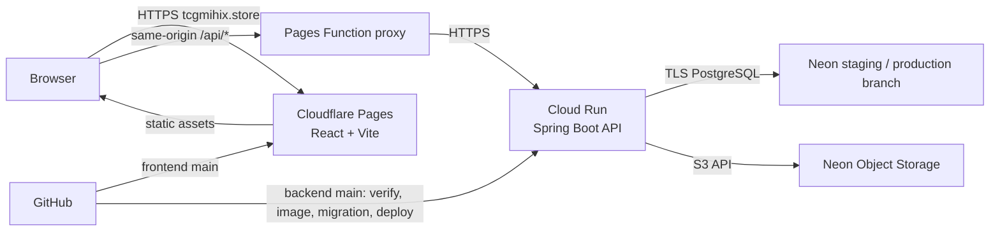

# แผนขึ้น Cloud แบบ Free-first สำหรับ TCG Store

ตรวจ provider/pricing: 10 พฤศจิกายน 2026  
Domain ที่ผู้ใช้ให้มา: `tcgmihix.store` (จดทะเบียนกับ GoDaddy)  
ขอบเขต: frontend + backend + Neon เดิม; ไม่ย้าย database

## ข้อสรุป

แนวทางเริ่มต้นที่แนะนำ:

- **Frontend/domain:** Cloudflare Pages ให้บริการ `https://tcgmihix.store` และ `www.tcgmihix.store`
- **Backend:** Google Cloud Run ใช้ Docker image ปัจจุบัน และ URL ต้นทาง `*.run.app`
- **API route ภายใต้ domain:** Cloudflare Pages Function proxy `/api/*` ไปยัง Cloud Run; frontend ใช้ `VITE_API_BASE_URL=/api`
- **Database:** Neon PostgreSQL เดิม แยก staging/production branch
- **รูปภาพ:** Neon Object Storage แบบ S3-compatible หาก bucket มีอยู่ใน Neon แล้ว
- **CI/CD:** GitHub Actions ตรวจ/ทดสอบ; deploy จาก `main`; GitHub OIDC + Google Workload Identity Federation

Cloudflare Pages เสิร์ฟ frontend แบบ static ได้ตรงกับ Vite ส่วน Pages Function ทำให้ API อยู่ใต้ origin เดียวกันโดยไม่ต้องเพิ่ม Google Load Balancer หรือใช้ Cloud Run domain mapping ซึ่ง Google ยังระบุว่าเป็น Preview และไม่แนะนำสำหรับ production

## Google Cloud ทำ Kubernetes ได้ไหม?

ได้ ผ่าน **Google Kubernetes Engine (GKE)** ซึ่งเป็น Kubernetes ที่ Google จัดการให้:

- **Autopilot:** Google จัดการ node; คิดค่า CPU/memory/storage ตาม resources ที่ Pod ขอ
- **Standard:** ควบคุม node pool ได้มากกว่า; คิดค่า VM ของ node ตราบใดที่ยังอยู่
- GKE ให้ credit $74.40 ต่อเดือนต่อ billing account เทียบเท่าค่า cluster management $0.10/ชั่วโมงสำหรับ Autopilot หรือ zonal Standard cluster หนึ่งชุด แต่ credit นี้ไม่ครอบคลุม Pod/VM, load balancer, disk หรือ network; regional cluster fee ใช้ credit นี้ไม่ได้ ([GKE pricing](https://cloud.google.com/kubernetes-engine/pricing))

ดังนั้น **GKE ทำ Kubernetes ได้ แต่ไม่ใช่ทางเลือกฟรีสำหรับ API นี้**. ถ้าต้องใช้ Kubernetes จริง แนะนำ GKE Autopilot เพื่อลดภาระดูแล node และยอมรับค่า Pod/ingress ตามใช้; ถ้าเป้าหมายคือทดลอง Kubernetes โดยไม่เพิ่ม cloud bill ให้ใช้ Kind ในเครื่องก่อน ส่วน deploy cloud ที่ประหยัดที่สุดยังเป็น Cloud Run

## สแกน codebase

### Frontend — `tcg-store-frontend`

- React + TypeScript + Vite; `npm run build` สร้าง static output ที่ `dist`
- API URL อ่านจาก `VITE_API_BASE_URL`; รองรับ relative path `/api`
- มี Dockerfile/Nginx สำหรับ container อยู่แล้ว แต่ Pages ไม่จำเป็นต้องรัน container
- ยังไม่มี Pages Function proxy ใน repo

### Backend — `tcg-store-backend`

- Spring Boot / Java 21; Dockerfile multi-stage และรัน non-root
- Neon profile ใช้ `NEON_JDBC_URL`, `NEON_DB_USERNAME`, `NEON_DB_PASSWORD`; Hikari สูงสุด 5 connections/instance
- มี Flyway migration runner แยก ใช้ profile `neon,migration`
- มี Actuator liveness/readiness และ `GET /api/health`
- ใช้ S3-compatible object storage ผ่าน `OBJECT_STORAGE_*`; runbook ระบุ Neon Object Storage แต่ `neon.ts` ยังไม่ได้ประกาศ bucket จึงต้องยืนยัน bucket/credentials จริงก่อน deploy
- ยังไม่มี Cloud Run workflow

## Free-tier ที่ต้องคุม

| บริการ | Free quota/ข้อจำกัด |
|---|---|
| Cloudflare Pages static | Static asset requests ฟรีและไม่จำกัด; 500 builds/เดือน, build พร้อมกัน 1 งาน, 20 นาที/build, 20,000 files/site และ 25 MiB/file ([Pages limits](https://developers.cloudflare.com/pages/platform/limits/)) |
| Cloudflare Pages Functions | Requests นับรวม Workers Free ที่ 100,000 requests/วัน; API calls ผ่าน `/api/*` จึงนับ quota นี้ ([Functions pricing](https://developers.cloudflare.com/pages/functions/pricing/)) |
| Cloud Run | Request-based Free Tier 180,000 vCPU-seconds, 360,000 GiB-seconds และ 2 ล้าน requests/เดือน รวมต่อ billing account; 1 vCPU ใช้โควตา CPU ได้ราว 50 ชั่วโมงรับงาน/เดือน จึงอาจเริ่มคิดค่าใช้จ่ายก่อนครบ 2 ล้าน requests ([Cloud Run pricing](https://cloud.google.com/run/pricing)) |
| Neon Free | 100 CU-hours, 1 GB Postgres, 5 GB Object Storage และ 5 GB public transfer ต่อ project/เดือน; Postgres และ Object Storage ใช้ transfer quota ร่วมกัน ([Neon pricing](https://neon.com/pricing)) |
| Cloud Build/Artifact Registry | Cloud Build 2,500 build-minutes/เดือน; Artifact Registry 0.5 GiB storage free ต่อ billing account จึงควรลบ image เก่าด้วย cleanup policy ([Cloud Build](https://cloud.google.com/build/pricing), [Artifact Registry](https://cloud.google.com/artifact-registry/pricing)) |

Cloud Run ต้องผูก Google Cloud Billing account แม้จะใช้ Free Tier; outbound internet free quota 1 GiB/เดือนใช้ได้เฉพาะ North America จึงต้องเผื่อค่า egress หาก deploy region ในเอเชีย ([Cloud Billing/Free Tier](https://cloud.google.com/free), [Cloud Run networking](https://cloud.google.com/run/pricing)). เลือก Cloud Run region ให้ใกล้ Neon region เพื่อลด latency ของ DB มาก่อนเลือก region ที่ใกล้ผู้ใช้

## Architecture เมื่อใช้ domain

Pages Function route ใช้ file-based routing เช่น `functions/api/[[path]].ts` เพื่อรับ `/api` และ subpaths ต่อจากนั้น; ฟังก์ชันส่ง request ต่อไปยัง Cloud Run URL โดยรักษา method, path/query, Authorization, content type และ body และต้องไม่ cache response ของ API/auth ([Pages Function routing](https://developers.cloudflare.com/pages/functions/routing/)). ตั้ง production environment variable เช่น `API_ORIGIN=https://<cloud-run-service>.run.app`; frontend ตั้ง `VITE_API_BASE_URL=/api`.

Cloud Run ยังคงมี `run.app` origin โดยตรงอยู่ แต่ผู้ใช้หน้าเว็บเรียก API ผ่าน `tcgmihix.store/api`. Pages Functions free limit 100k/day เป็นเพดานหลักของ proxy; ถ้าใช้เกิน ให้เลือกเพิ่ม Workers plan หรือกลับไปเรียก Cloud Run โดยตรงและตั้ง CORS ให้ตรง domain

## Domain และ DNS (GoDaddy → Cloudflare)

1. เพิ่ม `tcgmihix.store` เป็น Cloudflare zone ด้วย Free plan; domain ยังคงจดทะเบียน/ต่ออายุกับ GoDaddy
2. ก่อนเปลี่ยน nameservers ตรวจ DNS records เดิมและเก็บ MX/TXT/CNAME ที่ยังใช้ (เช่น email, verification); ถ้ามี DNSSEC/DS record ให้ทำตามขั้นตอน Cloudflare ก่อนย้าย
3. คัดลอก nameservers ที่ Cloudflare จัดให้ แล้วเปลี่ยน authoritative nameservers ที่ GoDaddy; หลังจากนั้นจัดการ DNS records ผ่าน Cloudflare DNS
4. เชื่อม Pages project กับ apex `tcgmihix.store` ผ่านเมนู Custom domains ใน Pages; Cloudflare ระบุว่า apex domain ต้องใช้ Cloudflare nameservers/zone
5. เพิ่ม `www.tcgmihix.store` เป็น custom domain แล้วตั้ง redirect ไป apex หรือกลับกันให้เหลือ canonical host เดียว
6. ตั้ง Pages production branch เป็น `main`; preview deployments ต้องไม่ชี้ Neon production
7. ทดสอบ TLS, SPA refresh/deep routes, API proxy, login, upload/read/delete รูป และ browser console ก่อนเปิดใช้จริง

Cloudflare Pages ต้องผูก custom domain ผ่าน Pages dashboard; การใส่ CNAME เองโดยไม่เพิ่ม domain ให้ Pages อาจทำให้ resolve ไม่ได้. Apex domain ต้องใช้ Cloudflare nameservers; registrar ยังเป็น GoDaddy ([Pages custom domains](https://developers.cloudflare.com/pages/configuration/custom-domains/), [Cloudflare DNS setup](https://developers.cloudflare.com/dns/zone-setups/full-setup/setup/)).

## ขั้นตอน deploy

### 1. Neon/staging

- ยืนยัน Neon region, intended production branch และ object-storage bucket
- อย่าให้ public app ใช้ shared `development` branch; สร้าง/เลือก staging และ production branch ที่ตั้งใจไว้
- ตรวจข้อมูล/seed ที่จะเผยแพร่, สำรองข้อมูล และซ้อม Flyway migration บน staging
- ยืนยัน object storage `tcg-product-images` และ public-read policy เฉพาะรูปที่ควรเปิดเผย

### 2. Backend/Cloud Run

- ใช้ Dockerfile เดิม build image โดยผูก tag กับ Git SHA; เก็บ image ล่าสุดจำนวนจำกัด
- GitHub Actions ต้องผ่าน `./mvnw verify` ก่อน deploy จาก `main`
- ใช้ GitHub OIDC/WIF จำกัดเฉพาะ repository และ branch; เก็บ credentials ใน Google Secret Manager ไม่ใส่ใน source หรือ image ([Google WIF](https://cloud.google.com/iam/docs/workload-identity-federation-with-deployment-pipelines))
- Runtime env: `SPRING_PROFILES_ACTIVE=neon`, port 8080, `NEON_*`, `APP_JWT_SECRET`, `OBJECT_STORAGE_*`; จำกัด CORS ให้ `https://tcgmihix.store` (และ `www` เฉพาะถ้าใช้เป็น origin)
- เริ่ม Cloud Run แบบ request-based, min instances 0, max instances 1–2, CPU 1, memory 1 GiB; ตรวจ memory/latency/DB pool หลัง deploy
- ก่อน rollout ให้รัน migration job จาก image เดียวกันด้วย `neon,migration`; หยุด deploy หาก migration ไม่ผ่าน
- ตรวจ `GET /api/health`, Actuator readiness และรูปภาพ หลัง deploy

Cloud Run domain mapping แบบตรงถูกระบุเป็น Preview/limited availability และ Google ไม่แนะนำ production; ถ้าต้องมี API subdomain ในอนาคต ให้ประเมิน global external Application Load Balancer (มีค่าใช้จ่าย) แยกต่างหาก แผนนี้จึงใช้ Pages Function proxy ผ่าน `tcgmihix.store/api` แทน ([Cloud Run custom domains](https://cloud.google.com/run/docs/mapping-custom-domains)).

### 3. Frontend/Pages

- เชื่อม Pages กับ frontend repo; production branch `main`
- Build: `npm ci --legacy-peer-deps && npm run build`; output: `dist`
- Build env: `VITE_API_BASE_URL=/api`, `VITE_ENABLE_MOCK_API=false`
- เพิ่ม Pages Function proxy ใน `functions/api/[[path]].ts` และ Pages variable `API_ORIGIN`; route API แบบไม่ cache
- Deploy staging ด้วย Pages preview + Neon staging ก่อน แล้วทดสอบ auth, catalog, listing upload, checkout, order lifecycle และ admin paths

### 4. Cost guard/rollback/domain

- ตั้ง min instances เป็น 0, max instances 1–2 และ cleanup policy ของ Artifact Registry
- ตั้ง Google project budget alerts และ Cloud Run spend cap หาก billing account รองรับ; alert อย่างเดียวไม่หยุด billing และ spend cap อาจมี reporting delay ([budgets](https://cloud.google.com/billing/docs/how-to/budgets), [spend caps](https://cloud.google.com/billing/docs/how-to/budgets-spend-caps))
- เก็บ Cloud Run revision/Pages deployment ก่อนหน้า; app rollback ทำได้แยกจาก schema; database ใช้ forward-compatible migration หรือ restore Neon ตาม runbook
- GoDaddy ต่ออายุ domain ตามรอบที่ซื้อไว้; Cloudflare DNS/Pages ใช้ Free plan แต่ renewal ของ domain ไม่ใช่ cloud free tier
- ถ้าต้องการ Kubernetes จริง เปลี่ยน backend plan เป็น GKE Autopilot และทำ cost estimate ก่อนสร้าง cluster; GKE cluster credit ไม่ทำให้ workloads free

## Source of truth

- [GKE pricing](https://cloud.google.com/kubernetes-engine/pricing)
- [Cloudflare Pages limits](https://developers.cloudflare.com/pages/platform/limits/), [Pages Functions routing](https://developers.cloudflare.com/pages/functions/routing/), [Functions pricing](https://developers.cloudflare.com/pages/functions/pricing/)
- [Pages custom domains](https://developers.cloudflare.com/pages/configuration/custom-domains/), [Cloudflare nameserver setup](https://developers.cloudflare.com/dns/zone-setups/full-setup/setup/)
- [Cloud Run pricing](https://cloud.google.com/run/pricing), [custom-domain mapping](https://cloud.google.com/run/docs/mapping-custom-domains), [container contract](https://cloud.google.com/run/docs/container-contract)
- [Neon pricing](https://neon.com/pricing), [Neon Object Storage S3 compatibility](https://neon.com/blog/building-neon-object-storage)

