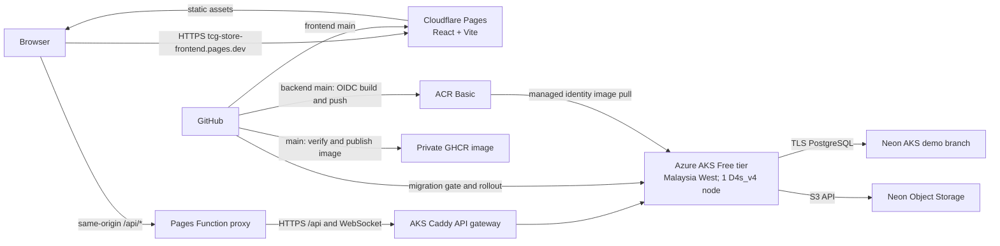

# แผนขึ้น Cloud สำหรับ TCG Store: Azure AKS

> **สถานะล่าสุด 11 พฤศจิกายน 2026:** frontend เปิดใช้งานที่
> <https://tcg-store-frontend.pages.dev/> บน Cloudflare Pages เพียงแห่งเดียว;
> Pages Function ส่ง `/api` และ WebSocket ไปยัง AKS API gateway ที่
> <https://tcgstore-demo-2026-11.malaysiawest.cloudapp.azure.com/>. AKS รัน
> backend Spring Boot และ Caddy สำหรับ API เท่านั้น; `/` ของ AKS ตอบ 404.
> Neon demo branch เชื่อมต่อได้, `/api/health` ผ่าน Pages ตอบ `UP` และ
> WebSocket ตอบ `101 Switching Protocols`. Frontend และ backend deploy จาก
> GitHub `main` อัตโนมัติ. ดู [API gateway runbook](../infra/kubernetes/overlays/aks-demo/api-gateway/README.md).
> การผูก `tcgmihix.store` ยังรอการเข้าถึง DNS ของ GoDaddy.

ตรวจ provider/pricing และปรับแผน: 11 พฤศจิกายน 2026
Domain ที่ผู้ใช้ให้มา: `tcgmihix.store` (จดทะเบียนกับ GoDaddy)
ขอบเขต: frontend + backend + Neon เดิม; ไม่ย้าย database

## ข้อสรุป

สถานะจริงหลังตั้งค่า Azure for Students:

- **Backend ใช้งานแล้ว:** AKS Free tier ใน `malaysiawest`, โหนด `Standard_D4s_v4` 1 ตัว, Deployment `1/1 Available` และ migration Job `Complete`
- **Registry:** ACR Basic `tcgstorecimah2026` ใน `centralindia`; GitHub Actions build backend จาก `main` แล้ว push digest ที่ pin ไป AKS โดยใช้ GitHub OIDC
- **Database:** Neon branch `aks-demo-2026-11-11` แยกจาก `development`, ลบอัตโนมัติ 18 พฤศจิกายน 2026; health check เชื่อมต่อได้และพบ 2,002 cards
- **คุมค่าใช้จ่าย:** ตั้ง budget `tcg-aks-demo-20usd` ที่ USD 20/เดือน พร้อม alert 25%, 50%, 75%; budget แจ้งเตือนแต่ไม่หยุดค่าใช้จ่าย

ส่วนที่เปิดให้ผู้ใช้เข้าถึงแล้วและงาน DNS ที่เหลือ:

- **Frontend/domain:** Cloudflare Pages ให้บริการ `https://tcg-store-frontend.pages.dev/` แล้ว; `tcgmihix.store` และ `www` ยังรอ DNS
- **Backend/Kubernetes:** AKS Free tier ที่สร้างแล้วใน Malaysia West; worker VM, disk และ network คิดแยกจาก control plane
- **API route:** Pages Function ส่ง `/api` ไปยัง AKS HTTPS API gateway; backend Service ภายในคลัสเตอร์ยังเป็น `ClusterIP`
- **Database:** ใช้ Neon demo branch ที่แยกจาก development สำหรับ AKS; คง production branch เดิมไว้
- **รูปภาพ:** Neon Object Storage แบบ S3-compatible หาก bucket มีอยู่ใน Neon แล้ว
- **CI/CD:** Cloudflare Pages deploy frontend จาก GitHub `main`; backend `deploy-aks-demo.yml` ทำงานหลัง `docker-build.yml` บน `main` สำเร็จ ใช้ GitHub OIDC ส่ง image เข้า ACR รัน migration แล้ว rollout AKS

Cloudflare Pages เสิร์ฟ Vite frontend แบบ static ต่อไป ส่วน AKS เป็น Kubernetes backend ที่เลือกสำหรับงานส่งโปรเจกต์ เพราะบัญชี Google Cloud แบบจ่ายเงิน/เครดิตทดลองเดิมใช้ไม่ได้แล้ว การรัน Kubernetes ในเครื่องช่วยทดสอบ manifest แต่ไม่ผ่านเงื่อนไข Grade A ที่ต้องมี workload ทำงานบน cloud จริง AKS Free ยกเว้นเฉพาะค่าจัดการ control plane; worker ไม่ฟรี และต้องลบทรัพยากรหลัง demo

## Backend Kubernetes: Azure AKS Free tier

- สร้าง AKS Free tier ใน `malaysiawest` แล้ว; Azure policy อนุญาต `malaysiawest`, `indonesiacentral`, `japaneast`, `centralindia`, `indiasouthcentral` และปฏิเสธ Southeast/East Asia. โหนด `Standard_D4s_v4` 1 ตัวใช้ 4 จาก quota 6 vCPU ใน region
- AKS Free tier ยกเว้นค่าบริการจัดการ control plane เท่านั้น และให้ best-effort uptime; worker VM, managed disk, network, public IP/load balancer ที่สร้างเพิ่ม และ traffic ยังคิดเงินตาม resource/SKU ที่ใช้ ([AKS pricing tiers](https://learn.microsoft.com/azure/aks/free-standard-pricing-tiers), [AKS system pool requirements](https://learn.microsoft.com/azure/aks/use-system-pools))
- Azure for Students มี quota จำกัดและไม่สามารถขอเพิ่ม quota ได้; ตรวจ regional/family vCPU quota และ SKU eligibility ใน portal/CLI ก่อนสร้าง ถ้าสร้าง AKS ไม่ได้ ให้ใช้ Linux Azure VM ที่ติดตั้ง K3s เป็น fallback cloud Kubernetes และตรวจหลักฐาน/ข้อกำหนดกับเกณฑ์รายวิชา
- Neon dashboard ที่ผู้ใช้ให้ดูมี compute 6.33 CU-hours, storage 55.75 MB และ transfer 0.1 GB ในช่วงที่แสดง; ตัวเลขนี้ช่วยประเมินโหลดแอปแต่ใช้แทนราคา worker Azure ไม่ได้
- ราคาขายปลีก Linux `D4s_v4` ใน Malaysia West ที่ตรวจ 11 พ.ย. 2026 คือประมาณ USD 0.22/ชั่วโมง และ ACR Basic ใน Central India ประมาณ USD 0.17/วัน; disk/network เพิ่มตามจริง. ตั้ง budget alert แล้ว

**เงื่อนไขคุมงบ:** ใช้ resource group แยกสำหรับ demo; ยืนยัน SKU/จำนวน node/ค่าใช้จ่ายก่อนสร้าง; ตั้ง budget alert; หลังส่งงานให้ลบ resource group และตรวจ managed resources, IP, LB, disk ที่ไม่ต้องเก็บ การ scale Pod ลงหรือหยุด frontend ไม่หยุดค่า worker/disk

## สแกน codebase

### Frontend — `tcg-store-frontend`

- React + TypeScript + Vite; `npm run build` สร้าง static output ที่ `dist`
- API URL อ่านจาก `VITE_API_BASE_URL`; รองรับ relative path `/api`; Pages Function proxy และ `_routes.json` เพิ่มแล้วใน branch `fix/cloud-workspace-setup` และรอ merge เข้า `main`
- มี Dockerfile/Nginx สำหรับ container อยู่แล้ว แต่ Pages ไม่จำเป็นต้องรัน container

### Backend — `tcg-store-backend`

- Spring Boot / Java 21; multi-stage Dockerfile รัน non-root และรองรับ multi-arch `amd64`/`arm64`
- `.github/workflows/docker-build.yml` รัน verify/security/supply-chain steps และ publish immutable GHCR image เมื่อ push `main`
- มี Kustomize base, Neon application/migration overlays, health probes, resource requests/limits, Flyway migration Job และ deploy script `scripts/deploy-neon-kubernetes.ps1` อยู่แล้ว
- `deploy-staging.yml`/`deploy-production.yml` เป็น workflow เดิมแบบ manual ที่ใช้ self-hosted runner; AKS demo ใช้ `deploy-aks-demo.yml` แยกต่างหากและมีผลรันสำเร็จแล้ว
- Neon profile ใช้ `NEON_JDBC_URL`, `NEON_DB_USERNAME`, `NEON_DB_PASSWORD`; Hikari สูงสุด 5 connections/instance
- มี Flyway migration runner แยก ใช้ profile `neon,migration`
- มี Actuator liveness/readiness และ `GET /api/health`
- AKS demo overlay ใส่ ACR image digest, CORS domain และ Neon demo branch storage endpoint แล้ว; Service ยังเป็น `ClusterIP` ไม่มี public ingress/TLS
- provision Kubernetes Secret 9 keys แล้ว; ใช้ ACR pull ผ่าน AKS managed identity โดยไม่ต้องใช้ GHCR token ใน cluster
- Neon demo branch มี bucket `tcg-product-images` แบบ public; object-storage credential ID ตรงกับใน `.env` ของเครื่อง

## Free-tier ที่ต้องคุม

| บริการ | Free quota/ข้อจำกัด |
|---|---|
| Cloudflare Pages static | Static asset requests ฟรีและไม่จำกัด; 500 builds/เดือน, build พร้อมกัน 1 งาน, 20 นาที/build, 20,000 files/site และ 25 MiB/file ([Pages limits](https://developers.cloudflare.com/pages/platform/limits/)) |
| Cloudflare Pages Functions | Requests นับรวม Workers Free ที่ 100,000 requests/วัน; API calls ผ่าน `/api/*` จึงนับ quota นี้ ([Functions pricing](https://developers.cloudflare.com/pages/functions/pricing/)) |
| Azure for Students | นักศึกษาที่เข้าเกณฑ์ได้เครดิต $100 ภายใน 12 เดือนโดยไม่ต้องใช้บัตร; มี spending limit ตามเครดิต แต่ quota จำกัดและขอเพิ่ม quota ไม่ได้ ตรวจ AKS cluster, regional vCPU และ SKU ก่อนสร้าง ([Students offer](https://azure.microsoft.com/en-us/pricing/offers/ms-azr-0170p), [Azure subscription quotas](https://learn.microsoft.com/azure/azure-subscription-service-limits), [VM vCPU quotas](https://learn.microsoft.com/azure/virtual-machines/quotas)) |
| AKS Free tier | ยกเว้นเฉพาะค่าจัดการ control plane และไม่มี financially backed SLA; worker VM, disk และ network resource คิดแยกตาม SKU/การใช้งาน ([AKS pricing tiers](https://learn.microsoft.com/azure/aks/free-standard-pricing-tiers)) |
| Neon Free | 100 CU-hours, 1 GB Postgres, 5 GB Object Storage และ 5 GB public transfer ต่อ project/เดือน; Postgres และ Object Storage ใช้ transfer quota ร่วมกัน ([Neon pricing](https://neon.com/pricing)) |

AKS Free ไม่ทำให้ worker compute ฟรี; Neon usage ต่ำเป็นข้อมูลช่วยประเมินโหลดแอป แต่ไม่ได้ยกเว้นค่า worker/disk/network ของ Azure

## Architecture เมื่อใช้ domain

Pages Function route ใช้ `functions/api/[[path]].ts` รับ `/api` และ subpaths แล้วส่งต่อไปยัง HTTPS AKS origin โดยรักษา method, path/query, Authorization, content type และ body; API response ตั้ง `no-store` และ WebSocket upgrade ส่งต่อได้ ([Pages Function routing](https://developers.cloudflare.com/pages/functions/routing/)). `API_ORIGIN` ตั้งใน Pages Production เป็น Azure HTTPS origin ปัจจุบัน.

ผู้ใช้หน้าเว็บเรียก API ผ่าน `tcg-store-frontend.pages.dev/api`; Pages Functions free limit 100k/day เป็นเพดานหลักของ proxy. หลังผูก `tcgmihix.store` ให้ทดสอบ hostname ใหม่และ CORS อีกครั้ง

## Domain และ DNS (GoDaddy → Cloudflare)

1. เพิ่ม `tcgmihix.store` เป็น Cloudflare zone ด้วย Free plan; domain ยังคงจดทะเบียน/ต่ออายุกับ GoDaddy
2. ก่อนเปลี่ยน nameservers ตรวจ DNS records เดิมและเก็บ MX/TXT/CNAME ที่ยังใช้ (เช่น email, verification); ถ้ามี DNSSEC/DS record ให้ทำตามขั้นตอน Cloudflare ก่อนย้าย
3. คัดลอก nameservers ที่ Cloudflare จัดให้ แล้วเปลี่ยน authoritative nameservers ที่ GoDaddy; หลังจากนั้นจัดการ DNS records ผ่าน Cloudflare DNS
4. เชื่อม Pages project กับ apex `tcgmihix.store` ผ่านเมนู Custom domains ใน Pages; Cloudflare ระบุว่า apex domain ต้องใช้ Cloudflare nameservers/zone
5. เพิ่ม `www.tcgmihix.store` เป็น custom domain แล้วตั้ง redirect ไป apex หรือกลับกันให้เหลือ canonical host เดียว
6. ตั้ง Pages production branch เป็น `main`; preview deployments ต้องไม่ชี้ Neon production
7. ทดสอบ TLS, SPA refresh/deep routes, API proxy, login, upload/read/delete รูป และ browser console ก่อนเปิดใช้จริง

Cloudflare Pages ต้องผูก custom domain ผ่าน Pages dashboard; การใส่ CNAME เองโดยไม่เพิ่ม domain ให้ Pages อาจทำให้ resolve ไม่ได้. Apex domain ต้องใช้ Cloudflare nameservers; registrar ยังเป็น GoDaddy ([Pages custom domains](https://developers.cloudflare.com/pages/configuration/custom-domains/), [Cloudflare DNS setup](https://developers.cloudflare.com/dns/zone-setups/full-setup/setup/)).

## ขั้นตอน deploy

### 1. Neon/staging

- ยืนยัน Neon region, intended production branch และ object-storage bucket
- อย่าให้ public app ใช้ shared `development` branch; สร้าง/เลือก staging และ production branch ที่ตั้งใจไว้
- ตรวจข้อมูล/seed ที่จะเผยแพร่, สำรองข้อมูล และซ้อม Flyway migration บน staging
- ยืนยัน object storage `tcg-product-images` และ public-read policy เฉพาะรูปที่ควรเปิดเผย

### 2. Backend/AKS

- สร้าง resource group `rg-tcg-store-aks-demo` และ **AKS Free tier** ใน `malaysiawest` แล้ว; โหนด `Standard_D4s_v4` 1 ตัวผ่าน quota และพร้อมใช้งาน
- `--tier free` ยกเว้นเฉพาะ control-plane management fee; worker VM และ disk/network ยังคิดเงิน. Free tier ไม่มี financially backed API-server SLA
- Dockerfile/build workflow ยัง publish multi-architecture image ใน GHCR เมื่อ merge `main`; สำหรับ AKS demo ใช้ Docker Buildx push ไป ACR เพราะ token ปัจจุบันไม่มี `read:packages` และ Azure for Students ไม่อนุญาต ACR Tasks. Pin ACR digest เดียวกันใน application และ migration overlays
- ใช้ `infra/kubernetes/overlays/aks-demo` และ migration overlay ที่ตั้งค่าแล้ว; API 1 replica, HPA 1..1, `ClusterIP`, probes และ ACR managed-identity pull
- GitHub `deploy-staging.yml`/`deploy-production.yml` ไม่ได้ใช้กับ AKS demo; `deploy-aks-demo.yml` deploy จาก `main` สำเร็จแล้วด้วย identity `id-tcg-github-aks-demo` ผ่าน OIDC และมีผล Actions run ให้เก็บเป็นหลักฐาน
- Runtime env: `SPRING_PROFILES_ACTIVE=neon`, port 8080, `NEON_*`, `APP_JWT_SECRET`, `OBJECT_STORAGE_*`; จำกัด CORS ให้ origin จริงของ frontend ที่ใช้กับ demo (domain production ใช้เมื่อ DNS/TLS พร้อม)
- รัน migration Job ก่อน rollout โดยใช้ image index digest เดียวกับ API และโปรไฟล์ `neon,migration`; หยุด deploy หาก Job ไม่สำเร็จ
- ตรวจ AKS resource, control-plane FQDN/cluster access, nodes, migration Job, ready pod และ `GET /api/health`/Actuator readiness; local Kubernetes อย่างเดียวไม่ผ่าน Grade A เพราะ workload ต้องรันบน cloud
- สำหรับ demo ปัจจุบัน Pages Function ใช้ AKS HTTPS endpoint ที่ Caddy รับ `/api`; `kubectl port-forward` เป็นวิธีตรวจภายในเพิ่มเติม

### 3. Frontend/Pages

- เชื่อม Pages กับ frontend repo; production branch `main`
- Build: `npm ci --legacy-peer-deps && npm run build`; output: `dist`
- Build env: `VITE_API_BASE_URL=/api`, `VITE_ENABLE_MOCK_API=false`
- เพิ่ม Pages Function proxy ใน `functions/api/[[path]].ts` และ Pages variable `API_ORIGIN`; route API แบบไม่ cache สำหรับช่วงทดลองให้ใช้ `pages.dev` หากยังเข้า GoDaddy/DNS ไม่ได้
- Deploy staging ด้วย Pages preview + Neon staging ก่อน แล้วทดสอบ auth, catalog, listing upload, checkout, order lifecycle และ admin paths

### 4. Cost guard/rollback/domain

- ตั้ง Azure budget alert และตรวจ estimate/usage ก่อนสร้าง; budget alert เป็นการแจ้งเตือน ไม่ใช่ hard spending cap
- เก็บ image index digest และ Pages deployment ก่อนหน้า; app rollback ทำได้แยกจาก schema; database ใช้ forward-compatible migration หรือ restore Neon ตาม runbook
- GoDaddy ต่ออายุ domain ตามรอบที่ซื้อไว้; Cloudflare DNS/Pages ใช้ Free plan แต่ renewal ของ domain ไม่ใช่ cloud free tier
- Kubernetes backend รอบส่งงาน: Azure AKS Free control plane ใน Malaysia West พร้อมโหนดจริง; หลังส่งงานวันที่ 14 พ.ย. ให้ตรวจว่าไม่ต้องเปิด demo ต่อก่อนลบ resource group
- K3s บน Azure VM เป็นแผนสำรองหาก AKS มีปัญหาในภายหลัง; ตอนนี้ AKS ใช้งานได้แล้ว

## Source of truth

- [AKS Free, Standard, Premium pricing tiers](https://learn.microsoft.com/azure/aks/free-standard-pricing-tiers)
- [AKS system node pool requirements](https://learn.microsoft.com/azure/aks/use-system-pools), [AKS quotas/SKU/region limits](https://learn.microsoft.com/azure/aks/quotas-skus-regions)
- [Azure subscription quotas](https://learn.microsoft.com/azure/azure-subscription-service-limits), [VM vCPU quotas](https://learn.microsoft.com/azure/virtual-machines/quotas), [Azure pricing calculator](https://azure.microsoft.com/pricing/calculator/)
- [Cloudflare Pages limits](https://developers.cloudflare.com/pages/platform/limits/), [Pages Functions routing](https://developers.cloudflare.com/pages/functions/routing/), [Functions pricing](https://developers.cloudflare.com/pages/functions/pricing/)
- [Pages custom domains](https://developers.cloudflare.com/pages/configuration/custom-domains/), [Cloudflare nameserver setup](https://developers.cloudflare.com/dns/zone-setups/full-setup/setup/)
- [Neon pricing](https://neon.com/pricing), [Neon Object Storage S3 compatibility](https://neon.com/blog/building-neon-object-storage)
