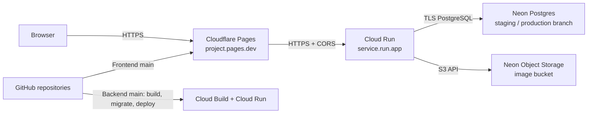

# แผนขึ้น Cloud แบบ Free-first สำหรับ TCG Store

วันที่ตรวจข้อมูลผู้ให้บริการ: 10 พฤศจิกายน 2026  
ขอบเขต: frontend และ backend จาก GitHub, ใช้ PostgreSQL บน Neon ต่อไป, ยังไม่ตั้ง domain name

## ข้อสรุป

แนะนำให้เริ่มด้วย **Cloudflare Pages + Google Cloud Run + Neon**:

- **Frontend:** Cloudflare Pages เสิร์ฟ Vite build จาก `dist` ผ่าน URL `*.pages.dev`
- **Backend:** Cloud Run รัน Docker image ของ Spring Boot ผ่าน URL `*.run.app`
- **Database:** ใช้ Neon PostgreSQL เดิม แต่แยก Neon branch สำหรับ staging และ production
- **รูปภาพผู้ขาย/ผู้ใช้:** ใช้ Neon Object Storage ที่ backend รองรับผ่าน S3 API หาก bucket ใน Neon มีอยู่แล้ว
- **CI/CD:** GitHub Actions ตรวจ CI; deploy เฉพาะหลัง merge เข้า `main`; ใช้ GitHub OIDC / Workload Identity Federation แทน service-account key ระยะยาว

ข้อเลือกนี้ตรงกับ codebase ปัจจุบัน: frontend เป็น static SPA และ backend มี Dockerfile, Neon profile, Flyway migration runner และ S3-compatible storage อยู่แล้ว จึงไม่ต้องเริ่มจาก Kubernetes หรือเพิ่ม database ตัวใหม่

**เงื่อนไขเรื่อง “ฟรี”:** Cloudflare Pages และ Neon มี free plan แบบ $0 ตาม quota แต่ Cloud Run ต้องมี Cloud Billing account และค่า network egress จาก region ในเอเชียอาจมีค่าใช้จ่าย จึงเรียกได้ว่า free-tier/ต้นทุนต่ำ ไม่ใช่รับประกันยอดบิล $0 หากต้องการ “ห้ามมี billing account หรือค่าใช้จ่ายเกินศูนย์เด็ดขาด” Cloud Run จะไม่ผ่านเงื่อนไขนั้น

## ผลสแกน repo

### Frontend — `tcg-store-frontend`

- React + TypeScript + Vite; build ด้วย `npm run build`, ไฟล์ออกที่ `dist`
- มี Dockerfile และ Nginx config สำหรับ container/Kubernetes อยู่แล้ว แต่ Pages สามารถเสิร์ฟ static build โดยไม่ต้องรัน Nginx container
- API URL อ่านจาก `VITE_API_BASE_URL`; ต้องใส่ URL Cloud Run ตอน build
- ตั้ง `VITE_ENABLE_MOCK_API=false` สำหรับ live backend
- ยังไม่มี Cloudflare Pages deploy configuration ใน repo

### Backend — `tcg-store-backend`

- Spring Boot / Java 21 มี multi-stage Dockerfile ใช้ non-root user
- Neon profile ใช้ `NEON_JDBC_URL`, `NEON_DB_USERNAME`, `NEON_DB_PASSWORD`; Hikari pool สูงสุด 5 connections ต่อ instance
- มี Flyway และ migration runner แยกจาก API แล้ว ใช้ `DatabaseMigrationApplication` กับ profile `neon,migration`
- มี Actuator liveness/readiness และ `GET /api/health`
- รูปภาพใช้ S3-compatible object storage ผ่าน `OBJECT_STORAGE_*`; runbook ระบุ Neon Object Storage แต่ไฟล์ `neon.ts` ปัจจุบันยังไม่ได้ประกาศ bucket จึงต้องยืนยัน resource จริงใน Neon ก่อน deploy
- มี Kubernetes/Neon runbook อยู่แล้ว แต่ยังไม่มี Cloud Run deployment workflow

## ตัวเลือกและ free tier ปัจจุบัน

| ส่วน | ตัวเลือก | ข้อจำกัดที่มีผลกับงานนี้ |
|---|---|---|
| Static frontend | Cloudflare Pages Free | static asset requests ฟรีและไม่จำกัด; 500 builds/เดือน, build พร้อมกัน 1 งาน, timeout 20 นาที, ไม่เกิน 20,000 files และไฟล์เดี่ยวไม่เกิน 25 MiB ([Pages limits](https://developers.cloudflare.com/pages/platform/limits/), [GitHub integration](https://developers.cloudflare.com/pages/configuration/git-integration/github-integration/)) |
| Spring API | Cloud Run request-based billing | Free tier: 180,000 vCPU-seconds, 360,000 GiB-seconds และ 2 ล้าน requests/เดือน รวมต่อ billing account; ที่ 1 vCPU โควตา CPU เท่ากับประมาณ 50 ชั่วโมงที่กำลังรับงาน จึงอาจหมดก่อนโควตา requests ([Cloud Run pricing](https://cloud.google.com/run/pricing)) |
| PostgreSQL | Neon Free (คงของเดิม) | 100 CU-hours, 1 GB Postgres และ 5 GB public network transfer ต่อ project/เดือน; compute หยุดเมื่อใช้ quota หมดจนกว่าจะขึ้นรอบใหม่ ([Neon pricing](https://neon.com/pricing)) |
| Product/avatar images | Neon Object Storage | Free มี 5 GB storage; egress ใช้ quota public transfer 5 GB เดียวกับ Postgres และ Functions ใน project ([Neon pricing](https://neon.com/pricing), [Neon S3 compatibility](https://neon.com/blog/building-neon-object-storage)) |
| Build/container image | Cloud Build + Artifact Registry | Cloud Build มี 2,500 build-minutes/เดือนสำหรับ default `e2-standard-2`; Artifact Registry มี storage free 0.5 GiB ต่อ billing account จึงต้องตั้ง cleanup policy ลบ image เก่า ([Cloud Build pricing](https://cloud.google.com/build/pricing), [Artifact Registry pricing](https://cloud.google.com/artifact-registry/pricing)) |

Cloud Run มี region รวมถึง Bangkok และ Singapore แต่ free tier ของ outbound internet ให้ 1 GiB/เดือนเฉพาะ North America; เลือก region ให้ใกล้ Neon database ก่อนเพื่อลดเวลา query และพิจารณาค่า egress จริง ([Cloud Run regions/pricing](https://cloud.google.com/run/pricing)). อย่าตั้ง min instances มากกว่า 0 ในแผนเริ่มต้น เพราะจะทำให้มี compute ตอนว่างและเสียข้อดีของ request-based billing.

### ทำไมไม่เลือก Render Free สำหรับ backend

Render Free มี 512 MB RAM และ 0.1 CPU, sleep หลังไม่มี traffic 15 นาที และอาจใช้เวลาประมาณ 1 นาทีเพื่อกลับมารับ request; Render ระบุว่า free services เหมาะกับ hobby/test และไม่แนะนำ production นอกจากนี้มี 750 free instance-hours ต่อ workspace และอาจระงับ service จาก outbound traffic สูง ([Render free services](https://render.com/docs/free), [compute plans](https://render.com/docs/compute-plans)). จึงเสี่ยงกับ Spring Boot, Neon และ user-facing API มากกว่า Cloud Run

## สถาปัตยกรรมช่วงที่ยังไม่มี domain

Frontend และ API ใช้คนละ hostname ชั่วคราว จึงให้ frontend เรียก URL `run.app` โดยตรง และตั้ง CORS ใน backend เป็น origin ของ Pages production แบบตรงตัว ไม่เปิด wildcard กว้าง ๆ ต่อไปเมื่อมี domain ค่อยเปลี่ยน API base URL และ CORS origin แล้ว redeploy

## แผนดำเนินงาน

### 1. เตรียม Neon ก่อน

1. ตรวจ project, region, branch และขนาดข้อมูลใน Neon โดยไม่ใช้ shared `development` branch เป็นฐานของ production โดยตรง
2. สร้าง/เลือก Neon branch แยกสำหรับ staging และ production; เก็บข้อมูล production ที่ตั้งใจใช้ไว้ และไม่นำ seed/test accounts ที่ไม่ต้องการเผยแพร่ติดไปด้วย
3. ตรวจว่า `tcg-product-images` bucket มีจริง, ใช้ visibility ตามนโยบายรูป (public-read เฉพาะไฟล์ที่ควรเปิดเผย) และมี credentials ที่ backend ใช้ได้
4. ใช้ connection URL แบบ TLS และเปิด pooling เฉพาะเมื่อยืนยันว่า Hibernate/Flyway ทำงานกับ endpoint แบบนั้นได้; จำกัด Cloud Run instances เพื่อคุมจำนวน DB connections
5. สำรองข้อมูลก่อน migration production และซ้อม migration บน staging branch ก่อนทุกครั้ง

### 2. เตรียม backend deploy

1. ใช้ Dockerfile ปัจจุบัน build image แบบ immutable tag เป็น Git SHA ใน Artifact Registry; เก็บเฉพาะ image ล่าสุดจำนวนจำกัด
2. ตั้ง GitHub Actions ให้รัน `./mvnw verify` ก่อน build/deploy และ deploy จาก `main` เท่านั้น
3. ผูก GitHub Actions กับ Google Cloud ด้วย Workload Identity Federation/OIDC และจำกัด identity ให้เฉพาะ repo/branch ที่ deploy ได้ ไม่เก็บ JSON service-account key ใน GitHub secrets ([Google WIF for GitHub Actions](https://cloud.google.com/iam/docs/workload-identity-federation-with-deployment-pipelines))
4. ใส่ค่าลับใน Secret Manager: `NEON_JDBC_URL`, `NEON_DB_USERNAME`, `NEON_DB_PASSWORD`, `APP_JWT_SECRET`, และ object-storage access/secret key
5. ตั้ง runtime:
   - `SPRING_PROFILES_ACTIVE=neon`
   - `SERVER_PORT=8080` (ตรงกับ port เริ่มต้นของ Cloud Run; ตรวจให้แอปรับฟัง `0.0.0.0` และพิจารณา map จาก `PORT` โดยตรง)
   - `APP_CORS_ALLOWED_ORIGINS=https://<pages-project>.pages.dev`
   - `APP_JWT_SECRET` ใช้ค่า random แข็งแรง ไม่ใช้ development default
   - เติม `OBJECT_STORAGE_ENDPOINT`, `OBJECT_STORAGE_REGION`, `OBJECT_STORAGE_BUCKET`, `OBJECT_STORAGE_PUBLIC_BASE_URL`, `OBJECT_STORAGE_PATH_STYLE` และ credentials จาก Neon Object Storage
6. เริ่มด้วย Cloud Run request-based, min instances 0, max instances 1–2, CPU 1 และ memory 1 GiB; ค่านี้เป็นจุดเริ่มต้นให้วัดจริง ไม่ใช่รับประกันว่าจะอยู่ใน free quota
7. ใช้ migration job จาก image เดียวกันก่อน deploy API: `neon,migration` และ `DatabaseMigrationApplication`; ถ้า migration fail ให้หยุด rollout
8. หลัง deploy ตรวจ `/api/health`, Actuator readiness, login, catalog, upload/read/delete รูป และ log ของ migration

Cloud Run กำหนดให้ container รับฟัง port ที่ส่งผ่าน `PORT` (ปกติ 8080) ([container runtime contract](https://cloud.google.com/run/docs/container-contract)). ถ้าต้องใช้ Cloud Run native health probes ให้ตรวจ billing behavior ก่อน เพราะเอกสาร Cloud Run ปัจจุบันระบุให้ใช้ instance-based billing กับ probes; ช่วงแรกใช้ deployment smoke checks จาก `/api/health` และ readiness endpoint แทน ([billing settings](https://cloud.google.com/run/docs/configuring/billing-settings)).

### 3. เตรียม frontend

1. สร้าง Cloudflare Pages project จาก repo frontend; ตั้ง production branch เป็น `main`
2. Build command: `npm ci --legacy-peer-deps && npm run build`; output directory: `dist`
3. Production build variables:
   - `VITE_API_BASE_URL=https://<cloud-run-service>.run.app/api`
   - `VITE_ENABLE_MOCK_API=false`
4. ทดสอบ routes ของ SPA เมื่อ refresh หน้าโดยตรง, login/logout, API errors และภาพจาก object storage
5. จำกัด CORS backend ให้ตรง Pages production origin; จัดการ preview deployment แยกจาก production API/Neon branch

### 4. Release และ rollback

1. Deploy staging frontend/backend ต่อ staging Neon branch ก่อน
2. ผ่าน smoke/E2E ที่ครอบคลุม auth, listing/catalog, seller image upload, cart/checkout และ order lifecycle
3. ทำ Neon backup/restore point; รัน migration กับ production branch แล้ว deploy backend จาก image SHA เดียวกับที่ทดสอบ
4. Deploy Pages production หลัง API พร้อม แล้วตรวจ health และ browser flow
5. เก็บ Cloud Run revision ก่อนหน้าและ Pages deployment ก่อนหน้าไว้สำหรับ rollback; rollback app ได้ทันที ส่วน schema ให้แก้แบบ forward-compatible หรือ restore Neon ตาม runbook ห้ามใช้ `ddl-auto=update`
6. ตั้ง monthly project budget alerts และ Cloud Run spend cap หาก account รองรับ; spend cap ช่วยหยุด Cloud Run เมื่อถึงวงเงิน แต่ไม่ใช่ hard cap ทันทีและไม่ครอบคลุมทุกค่าใช้จ่ายของ project ([budget alerts](https://cloud.google.com/billing/docs/how-to/budgets), [spend caps](https://cloud.google.com/billing/docs/how-to/budgets-spend-caps))

Google Cloud ต้องมี billing account แม้ใช้ Free Tier; budget alert ปกติเป็นการแจ้งเตือน ไม่ได้หยุดการใช้จ่ายเอง ([Google Cloud Free Tier](https://cloud.google.com/free), [billing budgets](https://cloud.google.com/billing/docs/how-to/budgets)). Cloud Run spend cap ที่เปิดใช้ได้เป็นกลไกหยุด Cloud Run โดยเฉพาะ แต่การคิดยอดมีความล่าช้า จึงยังอาจมี overage เล็กน้อย ([Cloud Run spend cap behavior](https://cloud.google.com/run/docs/configuring/billing-settings)).

## Domain ภายหลัง

ระยะนี้ใช้ `pages.dev` และ `run.app` โดยยังไม่สร้าง DNS record หรือซื้อ domain เมื่อพร้อมค่อยเพิ่ม custom domain, เปิด TLS, เปลี่ยน `VITE_API_BASE_URL`, ปรับ `APP_CORS_ALLOWED_ORIGINS`, แล้ว deploy frontend/backend ใหม่ โดยไม่ย้าย database

## Source of truth

- Cloudflare Pages: [limits](https://developers.cloudflare.com/pages/platform/limits/), [GitHub integration](https://developers.cloudflare.com/pages/configuration/git-integration/github-integration/)
- Cloud Run: [pricing](https://cloud.google.com/run/pricing), [container contract](https://cloud.google.com/run/docs/container-contract), [billing settings](https://cloud.google.com/run/docs/configuring/billing-settings)
- Google Cloud: [Free Tier and billing requirement](https://cloud.google.com/free), [Cloud Build](https://cloud.google.com/build/pricing), [Artifact Registry](https://cloud.google.com/artifact-registry/pricing), [GitHub OIDC/WIF](https://cloud.google.com/iam/docs/workload-identity-federation-with-deployment-pipelines), [spend caps](https://cloud.google.com/billing/docs/how-to/budgets-spend-caps)
- Neon: [current pricing](https://neon.com/pricing), [S3-compatible Object Storage](https://neon.com/blog/building-neon-object-storage)
- Render comparison: [free service limits](https://render.com/docs/free), [compute plans](https://render.com/docs/compute-plans)

