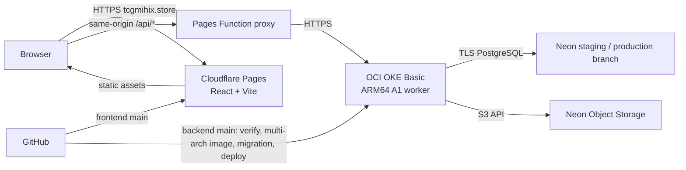

# แผนขึ้น Cloud แบบ Free-first สำหรับ TCG Store

ตรวจ provider/pricing: 10 พฤศจิกายน 2026  
Domain ที่ผู้ใช้ให้มา: `tcgmihix.store` (จดทะเบียนกับ GoDaddy)  
ขอบเขต: frontend + backend + Neon เดิม; ไม่ย้าย database

## ข้อสรุป

แนวทางเริ่มต้นที่แนะนำสำหรับ production แบบค่าใช้จ่ายต่ำ:

- **Frontend/domain:** Cloudflare Pages ให้บริการ `https://tcgmihix.store` และ `www.tcgmihix.store`
- **Backend/Kubernetes:** OCI OKE Basic Cluster + managed node pool หนึ่ง worker บน Ampere A1 Always Free
- **API route ภายใต้ domain:** Cloudflare Pages Function proxy `/api/*` ไปยัง OKE ingress/load balancer; frontend ใช้ `VITE_API_BASE_URL=/api`
- **Database:** Neon PostgreSQL เดิม แยก staging/production branch
- **รูปภาพ:** Neon Object Storage แบบ S3-compatible หาก bucket มีอยู่ใน Neon แล้ว
- **CI/CD:** GitHub Actions ตรวจ/ทดสอบ/build multi-arch image และ deploy manifests ไป OKE จาก `main`; ใช้ short-lived OCI auth/least privilege

Cloudflare Pages เสิร์ฟ frontend แบบ static ได้ตรงกับ Vite ส่วน Pages Function ทำให้ API อยู่ใต้ origin เดียวกันโดยไม่ต้องเพิ่ม Cloud Load Balancer แยกนอก cluster; OKE เป็น backend Kubernetes จริงของ deployment ตามข้อกำหนดโปรเจกต์ ข้อแลกเปลี่ยนคือ free node มีความเสี่ยง idle reclamation และไม่ให้ HA/SLA

เนื่องจาก Kubernetes เป็นส่วนหนึ่งของโปรเจกต์ ให้ใช้ **OCI OKE Basic Cluster + worker node OCI Ampere A1 Always Free** เป็น Kubernetes environment สำหรับ staging/ทดลอง deploy โดยแยกจาก production path ข้างต้นในช่วงแรก Basic Cluster ไม่มีค่าคลัสเตอร์และ A1 อยู่ใน Always Free แต่มีเพียง 2 OCPU/12 GB รวมต่อ tenancy และ instance ที่ idle ตามเกณฑ์ 7 วันอาจถูก reclaim จึงไม่ควรพึ่งเป็น production ที่ต้องพร้อมใช้งานต่อเนื่องโดยไม่มีงบสำรอง

## ตัวเลือก Kubernetes ฟรี: OCI OKE Basic + Ampere A1

OCI มีตัวเลือก Kubernetes ที่เข้ากับงบ $0 มากกว่า GKE:

- **OKE Basic Cluster:** ค่าบริการ cluster ฟรี; เลือก basic cluster เพื่อใช้ core Kubernetes และ managed node pool โดยไม่เปิด enhanced features ซึ่งคิดค่าบริการ ([Oracle Cloud price list](https://www.oracle.com/ca-en/cloud/price-list/), [Basic vs Enhanced](https://docs.oracle.com/en-us/iaas/Content/ContEng/Concepts/contengclustersnodes.htm))
- **Worker:** ใช้ VM.Standard.A1.Flex ใน Always Free ได้รวม 1,500 OCPU-hours และ 9,000 GB-hours ต่อเดือน เทียบเท่า **2 OCPU / 12 GB RAM รวมทั้ง tenancy** ตามเอกสารปัจจุบัน (เอกสาร/บทความเก่าที่ระบุ 4 OCPU / 24 GB ล้าสมัยแล้ว) ([Always Free resources](https://docs.oracle.com/en-us/iaas/Content/FreeTier/freetier_topic-Always_Free_Resources.htm))
- ใช้ **node เดียว** ขนาด 2 OCPU / 12 GB ก่อน; OKE รองรับ managed node pool บน Arm-based A1 แต่ architecture เป็น ARM64 จึงต้องเผยแพร่/ใช้ container image ที่รองรับ `linux/arm64` หรือ multi-arch ([OKE Arm nodes](https://docs.oracle.com/en-us/iaas/Content/ContEng/Tasks/contengrunningarmnodes.htm))
- OCI มี Always Free load balancer 10 Mbps และ outbound data 10 TB/เดือน แต่ต้องสร้าง/ผูก resource ใน home region และตรวจว่า Kubernetes Service/Ingress ที่เลือกไม่สร้าง resource ชนิดมีค่าใช้จ่ายเพิ่ม ([Always Free networking](https://docs.oracle.com/en-us/iaas/Content/FreeTier/freetier_topic-Always_Free_Resources.htm))

**ข้อจำกัด:** Always Free A1 อาจถูก reclaim เมื่อในช่วง 7 วัน CPU p95, network และ memory ใช้น้อยกว่า 20% ทั้งหมด; A1 ต้องผ่านเกณฑ์ memory ด้วย ดังนั้น cluster ที่รับงานน้อยมีโอกาสโดน reclaim; home region อาจไม่มี host capacity; single node ไม่มี HA และ OKE Basic ไม่มี financially-backed SLA ([idle reclamation และ capacity](https://docs.oracle.com/en-us/iaas/Content/FreeTier/freetier_topic-Always_Free_Resources.htm), [cluster types](https://docs.oracle.com/en-us/iaas/Content/ContEng/Concepts/contengclustersnodes.htm)). เก็บ state ที่ Neon/Object Storage และเตรียม backup/restore procedure

**แนวทางตามเป้าหมาย:** ใช้ OKE เป็น backend Kubernetes ของโปรเจกต์ตั้งแต่แผน deploy แรก โดยถือเป็น hobby/portfolio production ที่ยอมรับ downtime ได้; Cloud Run เป็น fallback หากต้องการลดภาระดูแล cluster แต่ความพร้อมใช้งานที่รับประกันต้องใช้งบกับ worker/redundancy

## Google Cloud ทำ Kubernetes ได้ไหม?

ได้ ผ่าน **Google Kubernetes Engine (GKE)** ซึ่งเป็น Kubernetes ที่ Google จัดการให้:

- **Autopilot:** Google จัดการ node; คิดค่า CPU/memory/storage ตาม resources ที่ Pod ขอ
- **Standard:** ควบคุม node pool ได้มากกว่า; คิดค่า VM ของ node ตราบใดที่ยังอยู่
- GKE ให้ credit $74.40 ต่อเดือนต่อ billing account เทียบเท่าค่า cluster management $0.10/ชั่วโมงสำหรับ Autopilot หรือ zonal Standard cluster หนึ่งชุด แต่ credit นี้ไม่ครอบคลุม Pod/VM, load balancer, disk หรือ network; regional cluster fee ใช้ credit นี้ไม่ได้ ([GKE pricing](https://cloud.google.com/kubernetes-engine/pricing))

ดังนั้น **GKE ทำ Kubernetes ได้ แต่ไม่ใช่ทางเลือกฟรีสำหรับ API นี้**. GKE Autopilot ลดภาระดูแล node แต่ Pod/Ingress ยังคิดเงิน; ใช้เมื่อยอมรับค่าใช้จ่ายและต้องการ GKE ecosystem/SLA มากกว่า OCI free tier

## สแกน codebase

### Frontend — `tcg-store-frontend`

- React + TypeScript + Vite; `npm run build` สร้าง static output ที่ `dist`
- API URL อ่านจาก `VITE_API_BASE_URL`; รองรับ relative path `/api`
- มี Dockerfile/Nginx สำหรับ container อยู่แล้ว แต่ Pages ไม่จำเป็นต้องรัน container
- ยังไม่มี Pages Function proxy ใน repo

### Backend — `tcg-store-backend`

- Spring Boot / Java 21; Dockerfile multi-stage และรัน non-root
- Neon profile ใช้ `NEON_JDBC_URL`, `NEON_DB_USERNAME`, `NEON_DB_PASSWORD`; Hikari สูงสุด 5 connections/instance
- มี Flyway migration runner แยก ใช้ profile `neon,migration`
- มี Actuator liveness/readiness และ `GET /api/health`
- ใช้ S3-compatible object storage ผ่าน `OBJECT_STORAGE_*`; runbook ระบุ Neon Object Storage แต่ `neon.ts` ยังไม่ได้ประกาศ bucket จึงต้องยืนยัน bucket/credentials จริงก่อน deploy
- ยังไม่มี Cloud Run workflow หรือ Kubernetes manifests/workflow สำหรับ OKE

## Free-tier ที่ต้องคุม

| บริการ | Free quota/ข้อจำกัด |
|---|---|
| Cloudflare Pages static | Static asset requests ฟรีและไม่จำกัด; 500 builds/เดือน, build พร้อมกัน 1 งาน, 20 นาที/build, 20,000 files/site และ 25 MiB/file ([Pages limits](https://developers.cloudflare.com/pages/platform/limits/)) |
| Cloudflare Pages Functions | Requests นับรวม Workers Free ที่ 100,000 requests/วัน; API calls ผ่าน `/api/*` จึงนับ quota นี้ ([Functions pricing](https://developers.cloudflare.com/pages/functions/pricing/)) |
| OCI OKE + A1 | OKE Basic Cluster ฟรี; A1 Free tenancy รวม 1,500 OCPU-hours + 9,000 GB-hours/เดือน (2 OCPU/12 GB); load balancer 10 Mbps และ outbound transfer 10 TB free; A1 idle instances may be reclaimed ([OCI Always Free](https://docs.oracle.com/en-us/iaas/Content/FreeTier/freetier_topic-Always_Free_Resources.htm), [OKE pricing](https://www.oracle.com/ca-en/cloud/price-list/)) |
| Cloud Run (fallback) | Request-based Free Tier 180,000 vCPU-seconds, 360,000 GiB-seconds และ 2 ล้าน requests/เดือน รวมต่อ billing account; 1 vCPU ใช้โควตา CPU ได้ราว 50 ชั่วโมงรับงาน/เดือน จึงอาจเริ่มคิดค่าใช้จ่ายก่อนครบ 2 ล้าน requests ([Cloud Run pricing](https://cloud.google.com/run/pricing)) |
| Neon Free | 100 CU-hours, 1 GB Postgres, 5 GB Object Storage และ 5 GB public transfer ต่อ project/เดือน; Postgres และ Object Storage ใช้ transfer quota ร่วมกัน ([Neon pricing](https://neon.com/pricing)) |
| Cloud Build/Artifact Registry | Cloud Build 2,500 build-minutes/เดือน; Artifact Registry 0.5 GiB storage free ต่อ billing account จึงควรลบ image เก่าด้วย cleanup policy ([Cloud Build](https://cloud.google.com/build/pricing), [Artifact Registry](https://cloud.google.com/artifact-registry/pricing)) |

OCI Free Tier ต้องยืนยัน account/region capacity และ Always Free eligibility ของ resource ทุกชิ้นก่อนสร้าง; เลือก OCI home region ให้ใกล้ Neon เพื่อจำกัด DB latency

## Architecture เมื่อใช้ domain

Pages Function route ใช้ file-based routing เช่น `functions/api/[[path]].ts` เพื่อรับ `/api` และ subpaths ต่อจากนั้น; ฟังก์ชันส่ง request ต่อไปยัง OKE ingress/load balancer URL โดยรักษา method, path/query, Authorization, content type และ body และต้องไม่ cache response ของ API/auth ([Pages Function routing](https://developers.cloudflare.com/pages/functions/routing/)). ตั้ง production environment variable เช่น `API_ORIGIN=https://<oke-ingress-host>`; frontend ตั้ง `VITE_API_BASE_URL=/api`.

ผู้ใช้หน้าเว็บเรียก API ผ่าน `tcgmihix.store/api`; Pages Functions free limit 100k/day เป็นเพดานหลักของ proxy; ถ้าใช้เกินให้เลือกเพิ่ม Workers plan หรือเรียก ingress โดยตรงและตั้ง CORS ให้ตรง domain

## Domain และ DNS (GoDaddy → Cloudflare)

1. เพิ่ม `tcgmihix.store` เป็น Cloudflare zone ด้วย Free plan; domain ยังคงจดทะเบียน/ต่ออายุกับ GoDaddy
2. ก่อนเปลี่ยน nameservers ตรวจ DNS records เดิมและเก็บ MX/TXT/CNAME ที่ยังใช้ (เช่น email, verification); ถ้ามี DNSSEC/DS record ให้ทำตามขั้นตอน Cloudflare ก่อนย้าย
3. คัดลอก nameservers ที่ Cloudflare จัดให้ แล้วเปลี่ยน authoritative nameservers ที่ GoDaddy; หลังจากนั้นจัดการ DNS records ผ่าน Cloudflare DNS
4. เชื่อม Pages project กับ apex `tcgmihix.store` ผ่านเมนู Custom domains ใน Pages; Cloudflare ระบุว่า apex domain ต้องใช้ Cloudflare nameservers/zone
5. เพิ่ม `www.tcgmihix.store` เป็น custom domain แล้วตั้ง redirect ไป apex หรือกลับกันให้เหลือ canonical host เดียว
6. ตั้ง Pages production branch เป็น `main`; preview deployments ต้องไม่ชี้ Neon production
7. ทดสอบ TLS, SPA refresh/deep routes, API proxy, login, upload/read/delete รูป และ browser console ก่อนเปิดใช้จริง

Cloudflare Pages ต้องผูก custom domain ผ่าน Pages dashboard; การใส่ CNAME เองโดยไม่เพิ่ม domain ให้ Pages อาจทำให้ resolve ไม่ได้. Apex domain ต้องใช้ Cloudflare nameservers; registrar ยังเป็น GoDaddy ([Pages custom domains](https://developers.cloudflare.com/pages/configuration/custom-domains/), [Cloudflare DNS setup](https://developers.cloudflare.com/dns/zone-setups/full-setup/setup/)).

## ขั้นตอน deploy

### 1. Neon/staging

- ยืนยัน Neon region, intended production branch และ object-storage bucket
- อย่าให้ public app ใช้ shared `development` branch; สร้าง/เลือก staging และ production branch ที่ตั้งใจไว้
- ตรวจข้อมูล/seed ที่จะเผยแพร่, สำรองข้อมูล และซ้อม Flyway migration บน staging
- ยืนยัน object storage `tcg-product-images` และ public-read policy เฉพาะรูปที่ควรเปิดเผย

### 2. Backend/OCI OKE

- สร้าง OKE **Basic** cluster และ managed node pool หนึ่ง node ใน Always Free home region; ก่อน apply ตรวจ quota, ARM-compatible node image, networking/IP/LB resources และราคาใน tenancy
- ใช้ Dockerfile/build workflow สร้าง multi-arch `linux/arm64` image ผูก tag กับ Git SHA; เก็บ image ใน GHCR หรือ registry ที่เลือกและตั้ง cleanup
- สร้าง Kubernetes manifests สำหรับ Deployment, Service, ingress, readiness/liveness probes, resource requests/limits และ Secret/config; จำกัด JVM/container memory ให้เหลือ headroom สำหรับระบบบน 12 GB node
- GitHub Actions ต้องผ่าน `./mvnw verify` ก่อน deploy จาก `main`; ใช้ OCI authentication แบบจำกัดสิทธิ์ใน CI และเก็บ key material เป็น protected GitHub secret หากยังใช้ federation ไม่ได้
- Runtime env: `SPRING_PROFILES_ACTIVE=neon`, port 8080, `NEON_*`, `APP_JWT_SECRET`, `OBJECT_STORAGE_*`; จำกัด CORS ให้ `https://tcgmihix.store` (และ `www` เฉพาะถ้าใช้เป็น origin)
- ก่อน rollout ให้รัน migration Job จาก image เดียวกันด้วย `neon,migration`; หยุด deploy หาก migration ไม่ผ่าน
- ตรวจ `GET /api/health`, Actuator readiness, ingress/TLS และรูปภาพหลัง deploy; สร้างวิธี backup/restore และขั้นตอนสร้าง cluster/node ใหม่หากโดน reclaim

### 3. Frontend/Pages

- เชื่อม Pages กับ frontend repo; production branch `main`
- Build: `npm ci --legacy-peer-deps && npm run build`; output: `dist`
- Build env: `VITE_API_BASE_URL=/api`, `VITE_ENABLE_MOCK_API=false`
- เพิ่ม Pages Function proxy ใน `functions/api/[[path]].ts` และ Pages variable `API_ORIGIN`; route API แบบไม่ cache
- Deploy staging ด้วย Pages preview + Neon staging ก่อน แล้วทดสอบ auth, catalog, listing upload, checkout, order lifecycle และ admin paths

### 4. Cost guard/rollback/domain

- ตั้ง budget alert/resource quota ที่ OCI และตรวจ billing dashboard เป็นระยะ; Always Free eligibility ต้องดูใน resource/tenancy จริง
- เก็บ image tag และ Pages deployment ก่อนหน้า; app rollback ทำได้แยกจาก schema; database ใช้ forward-compatible migration หรือ restore Neon ตาม runbook
- GoDaddy ต่ออายุ domain ตามรอบที่ซื้อไว้; Cloudflare DNS/Pages ใช้ Free plan แต่ renewal ของ domain ไม่ใช่ cloud free tier
- Kubernetes backend: OCI OKE **Basic** + A1 Always Free node; ตรวจ invoice/resource ที่สร้างจริง โดยเฉพาะ load balancer, public IP, boot volume และ enhanced cluster/virtual node ที่อาจมีค่าใช้จ่าย; A1 idle reclamation เป็นความเสี่ยงของ availability
- หากต้องการ production Kubernetes แบบมี SLA ให้ประเมิน OKE Enhanced หรือ GKE และ worker/egress/LB costs ก่อน; คลัสเตอร์ฟรีอย่างเดียวไม่ได้ทำให้ workload ฟรี

## Source of truth

- [GKE pricing](https://cloud.google.com/kubernetes-engine/pricing)
- [OCI OKE Basic/Enhanced cluster types](https://docs.oracle.com/en-us/iaas/Content/ContEng/Concepts/contengclustersnodes.htm), [OKE Arm nodes](https://docs.oracle.com/en-us/iaas/Content/ContEng/Tasks/contengrunningarmnodes.htm), [OCI Always Free resources, A1 limits and idle reclamation](https://docs.oracle.com/en-us/iaas/Content/FreeTier/freetier_topic-Always_Free_Resources.htm), [OCI price list](https://www.oracle.com/ca-en/cloud/price-list/)
- [Cloudflare Pages limits](https://developers.cloudflare.com/pages/platform/limits/), [Pages Functions routing](https://developers.cloudflare.com/pages/functions/routing/), [Functions pricing](https://developers.cloudflare.com/pages/functions/pricing/)
- [Pages custom domains](https://developers.cloudflare.com/pages/configuration/custom-domains/), [Cloudflare nameserver setup](https://developers.cloudflare.com/dns/zone-setups/full-setup/setup/)
- [Cloud Run pricing](https://cloud.google.com/run/pricing), [custom-domain mapping](https://cloud.google.com/run/docs/mapping-custom-domains), [container contract](https://cloud.google.com/run/docs/container-contract)
- [Neon pricing](https://neon.com/pricing), [Neon Object Storage S3 compatibility](https://neon.com/blog/building-neon-object-storage)

