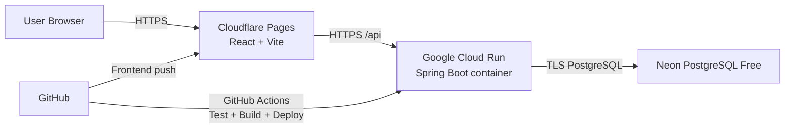
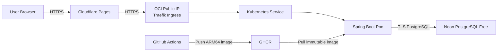

# Kubernetes และแผนนำ Mythix TCG Store ขึ้น Production แบบ Free-first

> อัปเดตข้อมูลและราคา ณ วันที่ 15 กันยายน 2026
> ขอบเขต: `tcg-store-frontend`, `tcg-store-backend` และ PostgreSQL
> เป้าหมาย: อธิบาย Kubernetes, ประเมินว่าจำเป็นหรือไม่, วางแผน Kubernetes ก่อน และวางแผน Production ต่อโดยเริ่มจากบริการที่มี Free Tier

## 1. Executive summary

### คำตอบสั้นที่สุด

**ไม่จำเป็นต้องทำ Kubernetes ก่อนนำระบบนี้ขึ้น Production**

Kubernetes ช่วยจัดการ container จำนวนมาก, การ scale, rolling update, self-healing และการกระจาย workload ข้ามหลายเครื่อง แต่ระบบปัจจุบันมี frontend แบบ static SPA, backend Spring Boot หนึ่ง service และ PostgreSQL หนึ่งฐานข้อมูล จึงยังไม่มีความซับซ้อนมากพอที่จะชดเชยภาระการดูแล cluster

ถ้าเงื่อนไขหลักคือ **ค่าใช้จ่าย $0 และต้องเปิดให้คนทดลองใช้งานได้เร็ว** สถาปัตยกรรมที่แนะนำคือ:

- Frontend: **Cloudflare Pages Free**
- Backend: **Google Cloud Run Free Tier**
- Database: **Neon Free PostgreSQL**
- Source/CI: **GitHub + GitHub Actions**
- URL เริ่มต้น: ใช้ `pages.dev`, `run.app` และ hostname ของ Neon จึงยังไม่ต้องซื้อ domain

สถาปัตยกรรมนี้ไม่ใช้ Kubernetes แต่ดูแลง่ายกว่า, scale-to-zero ได้ และเหมาะกับ demo, portfolio, university project หรือระบบใช้งานน้อย

ถ้าจุดประสงค์คือ **ต้องการเรียน Kubernetes หรือมี requirement บังคับ** ให้ทำเส้นทางคู่ขนาน:

- Frontend: Cloudflare Pages Free
- Backend Kubernetes: **k3s บน OCI Always Free Ampere A1 VM**
- Database: Neon Free PostgreSQL ซึ่งอยู่นอก cluster
- Container registry: GitHub Container Registry (GHCR)
- Ingress/TLS: Traefik ที่มากับ k3s + Let's Encrypt

เส้นทาง Kubernetes แบบฟรีนี้เป็น **single-node learning/hobby production** ไม่ใช่ high availability production เพราะ VM หรือ node เดียวล่มแล้ว backend จะหยุดทั้งหมด และ OCI อาจ reclaim Always Free instance ที่เข้าเกณฑ์ idle

### ข้อแนะนำสุดท้าย

1. ทำ application production-readiness ก่อน เพราะต้องใช้ทั้งสองเส้นทาง
2. เปิด staging ด้วย Docker Compose หรือ local Kubernetes
3. เปิด production จริงด้วย Cloudflare Pages + Cloud Run + Neon
4. ทำ k3s บน OCI เป็น lab/staging เพื่อเรียน Kubernetes
5. ย้าย production ไป managed Kubernetes เมื่อมีเหตุผลจริง เช่น มีหลาย backend services, มี traffic ต่อเนื่อง, ต้องการ autoscaling/HA หรือมีงบประมาณ

---

## 2. สถานะของโปรเจกต์ปัจจุบัน

### Frontend

- React 19 + TypeScript + Vite 8
- Build command: `npm run build`
- Output directory: `dist`
- API URL อ่านจาก `VITE_API_BASE_URL`
- มี CI สำหรับ lint, test และ build แล้ว
- เหมาะกับ static hosting/CDN โดยไม่ต้องสร้าง Kubernetes Pod สำหรับ frontend

### Backend

- Spring Boot 3.3.4 + Java 21
- Spring Web, Spring Data JPA, Spring Security และ JWT
- PostgreSQL driver
- มี Multi-stage Dockerfile และรันด้วย non-root user
- มี GitHub Actions ที่รัน `./mvnw verify`
- มี endpoint `GET /api/health`
- ตั้งค่า runtime ผ่าน environment variables ได้แก่ `DB_URL`, `DB_USERNAME`, `DB_PASSWORD`, `APP_CORS_ALLOWED_ORIGINS`, `APP_JWT_SECRET` และ `SERVER_PORT`

### Database

- PostgreSQL 16
- Local environment ใช้ Docker Compose
- Schema และ seed อยู่ใน `infra/postgres/init`
- JPA ใช้ `ddl-auto: validate`
- มีข้อมูลตัวอย่างการ์ดประมาณ 2,000 รายการ

### ช่องว่างก่อน Production

| เรื่อง | สถานะปัจจุบัน | สิ่งที่ต้องทำ |
|---|---|---|
| Database migration | ใช้ init SQL สำหรับสร้าง volume ครั้งแรก | เพิ่ม Flyway หรือ Liquibase และแยก migration ออกจาก development seed |
| Health probes | `/api/health` query database และนับ cards | แยก liveness ออกจาก readiness; liveness ต้องไม่พังเพียงเพราะ DB ล่ม |
| Secret | มี development default สำหรับ JWT secret | Production ต้องบังคับส่ง secret และห้าม fallback เป็นค่า default |
| CORS | default เป็น `localhost:5173` | ตั้งเป็น frontend production origin แบบเจาะจง |
| Release image | มีเพียง CI test | เพิ่ม workflow build/push image ด้วย immutable tag เช่น Git SHA |
| Deployment | มี Docker Compose สำหรับ local | เพิ่ม Cloud Run config หรือ Kubernetes manifests |
| Observability | มี application log พื้นฐาน | เพิ่ม structured logging, uptime check และ alert |
| Backup | Local volume เท่านั้น | ตั้ง automated logical backup และทดสอบ restore |
| API contract | ยังมีชื่อและ endpoint บางส่วนไม่ตรง frontend/Jira | ปิด open decisions ก่อนเปิด public production |

---

## 3. Kubernetes คืออะไร

Kubernetes หรือ K8s เป็นระบบจัดการ container แบบ declarative เราระบุว่า “ระบบควรอยู่ในสภาพใด” แล้ว Kubernetes จะพยายามรักษาสภาพนั้นไว้ เช่น ต้องมี backend 2 instances, ใช้ image version ใด, เปิด port ใด และต้อง restart เมื่อไม่ healthy

### คำศัพท์หลักและการประยุกต์กับโปรเจกต์นี้

| Kubernetes object | หน้าที่ | ใช้กับ Mythix อย่างไร |
|---|---|---|
| Cluster | กลุ่มเครื่องที่รัน Kubernetes | สภาพแวดล้อมที่ backend ทำงาน |
| Node | เครื่อง VM/physical machine ใน cluster | OCI VM หนึ่งเครื่องในแผนฟรี |
| Pod | หน่วยรัน container ที่เล็กที่สุด | หนึ่ง Pod รัน Spring Boot backend หนึ่ง instance |
| Deployment | ควบคุมจำนวน Pod และ rollout version ใหม่ | กำหนด backend replicas และ rolling update |
| Service | ให้ชื่อและ virtual IP ที่คงที่กับ Pods | ส่ง traffic ภายใน cluster ไป port 8080 |
| Ingress | รับ HTTP/HTTPS จากภายนอกและ route เข้า Service | เปิด `api.example.com` หรือ public IP ให้ backend |
| ConfigMap | เก็บ config ที่ไม่ลับ | CORS origin, log level, profile |
| Secret | เก็บค่าลับในรูป object | DB password และ JWT secret; ไม่ควร commit YAML ที่มีค่าจริง |
| Namespace | แยก resource เป็นกลุ่ม | แยก `mythix-staging` กับ `mythix-production` |
| Probe | ตรวจ startup, liveness, readiness | ควบคุมว่า Pod พร้อมรับ traffic หรือควร restart |
| HPA | เพิ่ม/ลดจำนวน Pod ตาม load | ใช้เมื่อมีหลาย node และ traffic มากพอ |
| PDB | จำกัดจำนวน Pod ที่หยุดพร้อมกัน | มีประโยชน์เมื่อ production มีอย่างน้อย 2 replicas/หลาย node |
| Job | งานที่ทำครั้งเดียวแล้วจบ | ใช้รัน database migration ก่อน rollout |

### สิ่งที่ Kubernetes ทำให้

- Restart container ที่ล้ม
- คงจำนวน replicas ตามที่กำหนด
- Rolling update และ rollback
- Service discovery ภายใน cluster
- แยก configuration และ secret ออกจาก image
- วาง resource requests/limits
- รองรับ autoscaling เมื่อมี metrics และหลาย node

### สิ่งที่ Kubernetes ไม่ได้ทำให้โดยอัตโนมัติ

- ไม่ทำให้ code ปลอดภัยหรือไร้ bug
- ไม่ทำ database backup ให้เอง
- ไม่ทำให้ single-node กลายเป็น high availability
- ไม่เข้ารหัส Kubernetes Secret โดยอัตโนมัติ; base64 ไม่ใช่ encryption
- ไม่ทำ DNS/domain registration ให้ทั้งหมด
- ไม่ทำ CI/CD ให้เอง
- ไม่ทำให้ infrastructure ฟรี; managed Kubernetes ส่วนใหญ่อยู่เหนือ Free Tier ของ compute

---

## 4. ต้องใช้ Kubernetes เมื่อไร

### ยังไม่ควรใช้เป็น production หลัก เมื่อ

- มี backend เพียง service เดียว
- ทีมยังไม่มีผู้ดูแล Linux/networking/Kubernetes
- traffic น้อยหรือไม่สม่ำเสมอ
- เป้าหมายสำคัญคือค่าใช้จ่าย $0
- downtime ระดับ demo ยอมรับได้
- serverless platform รองรับ container ได้ครบ

### ควรเริ่มพิจารณา เมื่อ

- แยก backend เป็นหลาย services/workers
- ต้องรัน background jobs, queues หรือ scheduled jobs หลายตัว
- ต้องการอย่างน้อย 2 replicas และหลาย availability zones
- traffic ต่อเนื่องจน serverless แพงกว่าการจอง compute
- ต้องการมาตรฐาน deployment เดียวกันข้ามหลาย cloud
- ทีมมี monitoring, on-call, backup และ patching process แล้ว

### Decision สำหรับโปรเจกต์นี้

| เป้าหมาย | ทางเลือก |
|---|---|
| เปิด demo ฟรีเร็วที่สุด | Cloudflare Pages + Cloud Run + Neon |
| เรียน Kubernetes | local `kind`/Docker Desktop แล้ว deploy k3s บน OCI |
| Production เชิงธุรกิจจริง มีผู้ใช้/การซื้อขายสำคัญ | ใช้บริการแบบ paid พร้อม SLA; managed database และอย่างน้อย 2 compute instances |
| ต้องใช้ Kubernetes ใน production จริง | GKE/AKS/EKS แบบ paid หรือ cluster หลาย node; ไม่ใช้ single-node free VM |

---

## 5. Architecture ที่เสนอ

### 5.1 Recommended: Free-first production/demo โดยไม่ใช้ Kubernetes



เหตุผล:

- Frontend เป็น static SPA จึงเหมาะกับ CDN
- Backend มี Dockerfile อยู่แล้วและ Cloud Run รับ container ได้โดยตรง
- Cloud Run scale-to-zero ทำให้ workload ที่มี request น้อยมีโอกาสอยู่ใน free quota
- Neon เป็น PostgreSQL จึงเปลี่ยน connection string โดยไม่เปลี่ยน JPA model
- แต่ละส่วนมี HTTPS endpoint ของผู้ให้บริการ จึงไม่ต้องซื้อ domain ในรอบแรก

ข้อจำกัด:

- Cold start อาจเกิดกับ backend และ database หลัง idle
- Free quotas เปลี่ยนได้และไม่ใช่คำรับประกันว่าจะ $0 ตลอดไป
- Google Cloud ต้องเปิด billing account แม้ใช้งานภายใน Free Tier
- Neon Free มี storage/compute quota และไม่เหมาะกับข้อมูลสำคัญที่ไม่มี backup ของเราเอง
- “ฟรี” ไม่เท่ากับ “มี SLA แบบ production เชิงธุรกิจ”

### 5.2 Kubernetes learning/hobby production ด้วย OCI



ข้อกำหนดของเส้นทางนี้:

- ใช้ k3s ซึ่งเบากว่า Kubernetes distribution เต็มรูปแบบ
- OCI A1 เป็น ARM64 ดังนั้น image ต้อง build เป็น `linux/arm64` หรือ multi-architecture
- เก็บ database นอก single-node cluster เพื่อลดความเสี่ยงข้อมูลหายเมื่อ node ล่ม
- เริ่มด้วย `replicas: 1`; การตั้ง 2 replicas บน node เดียวช่วยเรื่อง process crash แต่ไม่ช่วยเมื่อ node ล่ม
- HPA/PDB ยังไม่มีประโยชน์เต็มที่จนกว่าจะมีหลาย node

### 5.3 Target architecture เมื่อระบบโตและมีงบ

- Frontend อยู่บน CDN ต่อได้
- Backend อยู่ managed Kubernetes หรือ managed container platform อย่างน้อย 2 instances ในหลาย zones
- PostgreSQL เป็น managed paid plan พร้อม automated backup และ point-in-time recovery
- Secrets มาจาก cloud secret manager/External Secrets Operator
- Metrics, logs และ alert รวมศูนย์
- DNS, WAF, rate limiting และ TLS เป็น managed edge

---

## 6. เปรียบเทียบตัวเลือก Cloud/Platform ที่นิยม

### 6.1 Backend และ Kubernetes

| Provider | ตัวเลือก | ฟรีจริงระยะยาวหรือไม่ | เหมาะกับโปรเจกต์นี้ |
|---|---|---:|---|
| Google Cloud | Cloud Run | มี monthly Free Tier; คิดเงินเมื่อเกิน quota | **แนะนำสำหรับ backend production/demo** |
| Google Cloud | GKE | Free credit ครอบคลุม cluster management ของหนึ่ง Autopilot/zonal cluster แต่ compute และ resource อื่นยังคิดเงิน | ไม่เหมาะกับเงื่อนไข $0 แบบแน่นอน |
| AWS | EKS | ไม่ฟรี; control plane standard มีค่ารายชั่วโมง และยังมี worker/network/storage | ไม่เลือกในแผนฟรี |
| Azure | AKS Free tier | control-plane management ฟรี แต่ worker VM และ resource ที่ใช้ยังคิดเงิน; Free tier ไม่มี SLA | เหมาะกับ lab มากกว่า free production |
| Oracle Cloud | OCI Always Free VM + k3s | มี Always Free compute ภายใต้ quota และข้อจำกัด | **แนะนำเฉพาะเส้นทางเรียน Kubernetes** |
| Railway | Free plan | มีเครดิตใช้งาน $1 ต่อเดือน; ทรัพยากร JVM อาจเกินเครดิตได้ง่าย | ใช้ทดลองได้ แต่ไม่ใช่ตัวเลือกหลัก |
| Render | Free web service | ฟรีแต่ sleep หลัง idle และเอกสารระบุไม่ให้ใช้กับ production | ใช้ demo สำรองได้ ไม่ใช่ตัวเลือกหลัก |
| Fly.io | Machines | ไม่มี permanent Free Tier มีเพียง trial | ไม่เลือกในแผนฟรี |

หมายเหตุสำคัญ:

- GKE ให้เครดิตค่า cluster management แต่ไม่ได้แปลว่า Pod, Load Balancer, disk และ network ฟรีทั้งหมด
- AKS Free หมายถึง control-plane tier ไม่มีค่าบริหาร cluster แต่ node ยังมีค่าใช้จ่าย
- EKS standard support คิดค่าคลัสเตอร์ และ worker resources แยกต่างหาก
- OCI Always Free A1 ปัจจุบันให้ทรัพยากรรวมเทียบเท่า 2 OCPUs/12 GB RAM ต่อ tenancy ตามเอกสารที่ตรวจ ณ วันที่จัดทำ และ instance ที่ idle ตามเกณฑ์อาจถูก reclaim

### 6.2 Frontend

| Provider | Free plan | ข้อสังเกต | เลือกหรือไม่ |
|---|---|---|---|
| Cloudflare Pages | มี Free plan, Git integration, preview deployments, custom domain/TLS | เหมาะกับ Vite static SPA และไม่มีข้อจำกัด non-commercial ที่ระบุแบบ Vercel Hobby | **เลือก** |
| Vercel Hobby | ฟรีและ deploy Vite ได้ง่าย | จำกัดสำหรับ personal/non-commercial use | เลือกเมื่อเป็นงานส่วนตัวที่ไม่ทำการค้า |
| Azure Static Web Apps Free | ฟรี, global static hosting, TLS, GitHub integration | Free plan ไม่มี SLA และระบุเหมาะกับ personal project | ตัวเลือกสำรอง |
| Render Static Site | ฟรี | อยู่ใน platform เดียวกับ Render ได้ แต่ backend free มีข้อจำกัดมาก | ตัวเลือกสำรอง |

### 6.3 PostgreSQL

| Provider | Free plan ที่ตรวจสอบ | ความเสี่ยง | เลือกหรือไม่ |
|---|---|---|---|
| Neon | 0.5 GB storage/project, 100 CU-hours/month/project, scale-to-zero | cold start และ quota; ต้องทำ backup เองตามระดับความสำคัญ | **เลือกสำหรับรอบแรก** |
| Supabase | 500 MB database, 2 active projects, pause หลังไม่ active 1 สัปดาห์ | ไม่มี automatic backups ใน Free plan และเกิน 500 MB จะ read-only | ตัวเลือกสำรอง |
| Render Postgres Free | 1 GB แต่หมดอายุ 30 วันและไม่มี backup | ไม่เหมาะกับ production | ไม่เลือก |
| PostgreSQL ใน OCI VM/k3s | อยู่ใน compute free quota | ผูกข้อมูลกับ single node และทีมต้องดูแล backup/patching เอง | ไม่แนะนำสำหรับ production |

**ข้อสรุป:** ให้ใช้ managed PostgreSQL Free แยกจาก Kubernetes และ export backup ออกนอก provider เป็นประจำ

---

## 7. Phase A — แผนเตรียม Application ให้พร้อมก่อน Deploy

งานส่วนนี้ต้องทำไม่ว่าจะเลือก Kubernetes หรือ Cloud Run

### A1. ปิด API contract และ business-critical gaps

- ตรวจ frontend API clients เทียบ backend endpoints ทั้งหมด
- ปิด decision เรื่อง `USER`/`CUSTOMER`, `/orders/my-orders`/`/orders/me` และ `totalPrice`/`totalAmount`
- ปิด feature ที่ frontend เรียกแต่ backend ยังไม่มี หรือซ่อน UI ด้วย feature flag
- เพิ่ม integration tests สำหรับ login, catalog, listing, cart, order และ authorization

**Exit criteria**

- Frontend production build ใช้ real API และ critical flow ผ่าน
- ไม่มี endpoint สำคัญที่ frontend เรียกแล้วได้ 404/501
- `mvnw verify`, frontend lint/test/build ผ่าน

### A2. เพิ่ม production database migrations

- เพิ่ม Flyway dependency
- สร้าง `src/main/resources/db/migration/V1__baseline.sql`
- แยกข้อมูล development seed ออกจาก production migration
- ห้ามใช้ `infra/postgres/init/02-data.sql` เป็น production seed โดยอัตโนมัติ
- ใช้ forward-compatible migration เช่น add nullable column ก่อน backfill แล้วค่อยเพิ่ม constraint
- ทดสอบ migration จากฐานข้อมูลว่างและจาก snapshot เวอร์ชันก่อนหน้า

**Exit criteria**

- Backend start กับ database ว่างแล้วสร้าง schema ผ่าน migration
- Restart ซ้ำได้โดยไม่เปลี่ยนข้อมูล
- มีคำสั่ง backup/restore ที่ทดสอบแล้ว

### A3. แยก health endpoints

แนะนำเพิ่ม Spring Boot Actuator:

- `/actuator/health/liveness`: ตรวจว่า process/JVM ยังทำงาน ไม่ควร query DB
- `/actuator/health/readiness`: ตรวจ dependency ที่จำเป็น เช่น database
- `/api/health`: เก็บไว้เป็น diagnostic endpoint หากต้องการ แต่ไม่ใช้เป็น liveness เพราะปัจจุบัน query `cardRepository.count()`

**Exit criteria**

- ปิด DB แล้ว liveness ยังเป็น UP แต่ readiness เป็น DOWN
- เปิด DB กลับแล้ว readiness ฟื้นโดยไม่ restart Pod

### A4. Production configuration และ secrets

- เพิ่ม Spring profile `application-production.yml`
- Production ต้องไม่มี default JWT secret
- JWT secret อย่างน้อย 32 random bytes และ rotate ได้
- ใช้ database user เฉพาะ application ไม่ใช้ superuser
- บังคับ SSL ไป database เมื่อ provider รองรับ
- ตั้ง `APP_CORS_ALLOWED_ORIGINS` เป็น Cloudflare Pages production origin เท่านั้น
- ห้าม commit `.env`, kubeconfig, service-account key หรือ raw Secret

### A5. Container hardening

Dockerfile ปัจจุบันมี multi-stage และ non-root แล้ว ให้เพิ่ม/ตรวจ:

- Pin base image ด้วย version/digest ตาม release policy
- Build image ด้วย immutable tag: Git SHA
- เพิ่ม OCI labels เช่น source/revision/version
- กำหนด JVM container options เช่น `-XX:MaxRAMPercentage=75`
- รองรับ filesystem แบบ read-only และ writable `/tmp`
- สแกน image/dependencies ใน CI
- Build multi-arch (`linux/amd64,linux/arm64`) หากจะใช้ OCI A1

### A6. Logging และ monitoring

- Log เป็น structured JSON ใน production
- ใส่ request/correlation ID
- ห้าม log password, JWT, Authorization header หรือ PII ที่ไม่จำเป็น
- เพิ่ม external uptime monitor ที่ยิง readiness/public health
- ตั้ง alert อย่างน้อยสำหรับ availability, HTTP 5xx และ database storage quota

---

## 8. Phase B — แผน Kubernetes ก่อน

Phase นี้สร้างความพร้อม Kubernetes โดยไม่รีบให้ production traffic จริง

### B0. กำหนด environment และ convention

- Namespace: `mythix-staging`, `mythix-production`
- App label: `app.kubernetes.io/name: tcg-store-backend`
- Image tag: Git SHA ห้ามใช้ `latest`
- Config ที่ไม่ลับอยู่ ConfigMap
- Secret จริงสร้างใน cluster/secret manager ไม่อยู่ใน Git
- เลือก Kustomize สำหรับ project ขนาดนี้; ยังไม่จำเป็นต้องสร้าง Helm chart

โครงไฟล์เป้าหมาย:

```text
k8s/
├── base/
│   ├── namespace.yaml
│   ├── service-account.yaml
│   ├── configmap.yaml
│   ├── deployment.yaml
│   ├── service.yaml
│   └── kustomization.yaml
├── overlays/
│   ├── staging/
│   │   ├── kustomization.yaml
│   │   ├── ingress.yaml
│   │   └── patch-deployment.yaml
│   └── production/
│       ├── kustomization.yaml
│       ├── ingress.yaml
│       └── patch-deployment.yaml
└── README.md
```

### B1. Local cluster

- ใช้ `kind`, `minikube` หรือ Kubernetes ของ Docker Desktop
- สร้าง namespace staging
- สร้าง local secret จาก `.env` ที่ไม่ commit
- Deploy backend image และใช้ PostgreSQL local/temporary เฉพาะ integration test
- ใช้ `kubectl port-forward` ทดสอบก่อนเพิ่ม Ingress

คำสั่งตรวจพื้นฐาน:

```bash
kubectl kustomize k8s/overlays/staging
kubectl apply --dry-run=client -k k8s/overlays/staging
kubectl apply -k k8s/overlays/staging
kubectl rollout status deployment/tcg-store-backend -n mythix-staging
kubectl get pods,svc,ingress -n mythix-staging
```

### B2. Deployment specification

กำหนดอย่างน้อย:

- `replicas: 1` สำหรับ free single-node; paid production ใช้ 2+
- `RollingUpdate`, `maxUnavailable: 0`, `maxSurge: 1`
- `terminationGracePeriodSeconds: 30`
- startup, liveness และ readiness probes แยกกัน
- resource requests เริ่มต้นประมาณ `cpu: 250m`, `memory: 512Mi`
- resource limits เริ่มต้นประมาณ `cpu: 1`, `memory: 1Gi`
- JVM max RAM ต่ำกว่า container limit เพื่อเหลือ native/metaspace headroom
- `runAsNonRoot`, `allowPrivilegeEscalation: false`, `capabilities.drop: [ALL]`
- `readOnlyRootFilesystem: true` และ mount `emptyDir` ที่ `/tmp`
- dedicated ServiceAccount และ `automountServiceAccountToken: false`

ค่าทรัพยากรข้างต้นเป็น baseline ต้องปรับจาก metrics จริงหลัง load test

### B3. Service และ Ingress

- Backend Service ใช้ `ClusterIP`, port 80 ไป targetPort 8080
- Ingress terminate TLS และส่งต่อไป Service
- จำกัด public exposure ให้มีเพียง 80/443; Kubernetes API 6443 จำกัดด้วย firewall/IP allowlist
- ใช้ TLS certificate อัตโนมัติ
- ตั้ง request/body limits และ rate limiting ตาม API behavior
- หาก frontend ไม่มี custom domain ให้เริ่มจาก hostname ที่จัดหาให้หรือ nip.io สำหรับ lab เท่านั้น

### B4. ConfigMap และ Secret

ConfigMap:

- `APP_LOG_LEVEL=INFO`
- `SERVER_PORT=8080`
- `APP_CORS_ALLOWED_ORIGINS=<frontend-production-origin>`

Secret:

- `DB_URL`
- `DB_USERNAME`
- `DB_PASSWORD`
- `APP_JWT_SECRET`

ห้ามเก็บ raw Secret ใน repository ทางเลือกตามลำดับ maturity:

1. เริ่มต้น: สร้างด้วย `kubectl create secret ...` จาก CI secret
2. ดีขึ้น: SOPS + age และ encrypted secret ใน Git
3. Managed production: External Secrets Operator + cloud secret manager

### B5. Database migration Job

- แยก migration เป็น Kubernetes Job หรือให้ Flyway run ก่อน app รับ traffic
- Job และ Deployment ต้องใช้ image version เดียวกัน
- กำหนด `backoffLimit`, timeout และเก็บ log
- Deploy pipeline ต้องหยุดถ้า migration ล้มเหลว
- Schema change ต้อง backward-compatible กับ app version ก่อนหน้าเพื่อรองรับ rolling update/rollback

### B6. Reliability controls

สำหรับ single-node free lab:

- ใช้ replicas 1
- ไม่เปิด HPA เพราะ scale Pod บน node เดิมไม่ได้แก้ node failure และอาจกิน quota
- PDB ไม่ได้สร้าง HA เมื่อมี node เดียว

สำหรับ paid multi-node production:

- replicas อย่างน้อย 2
- topology spread/anti-affinity ให้ Pod กระจายข้าม nodes/zones
- HPA หลัง metrics-server พร้อมและมี resource requests
- PDB `maxUnavailable: 1`
- autoscaler สำหรับ node pool

### B7. Kubernetes security checklist

- [ ] Image ใช้ immutable SHA/digest
- [ ] Container non-root
- [ ] Root filesystem read-only
- [ ] Drop Linux capabilities ทั้งหมด
- [ ] ไม่ automount service account token
- [ ] Namespace แยก environment
- [ ] NetworkPolicy จำกัด egress/ingress เมื่อ CNI รองรับ
- [ ] Secret ไม่อยู่ใน Git/log
- [ ] Kubernetes API ไม่เปิดกว้างสู่ `0.0.0.0/0`
- [ ] OS และ k3s patch ตามรอบ
- [ ] Backup k3s state และทดสอบ restore

### B8. Local/Staging acceptance tests

- Pod start และผ่าน startup probe
- readiness เปลี่ยนเป็น false เมื่อ DB ใช้งานไม่ได้
- liveness ไม่ restart เพราะ DB outage อย่างเดียว
- Deployment version ใหม่ rollout โดย request สำคัญไม่ล้ม
- `kubectl rollout undo` คืน version ก่อนหน้าได้
- Secret ไม่ปรากฏใน GitHub Actions logs
- Resource usage หลัง load test อยู่ใต้ limit และไม่มี OOMKilled
- Authentication/authorization flow ผ่านจาก frontend staging

---

## 9. Phase C — Deploy Kubernetes บน OCI Always Free

> ใช้เพื่อเรียนรู้และ staging/hobby production เท่านั้น ไม่มี HA/SLA

### C1. Provision infrastructure

- สร้าง OCI tenancy และเลือก home region ใกล้ผู้ใช้ เช่น Singapore หาก capacity มี
- สร้าง Ubuntu ARM64 Always Free A1 instance ภายใน quota
- แนะนำเริ่ม 2 OCPU/12 GB RAM หาก quota อนุญาต
- ใช้ boot volume ภายใน Always Free allowance
- จอง public IP หากบริการรองรับโดยไม่เกิน quota
- เปิดเฉพาะ SSH จาก IP ผู้ดูแล, HTTP 80 และ HTTPS 443
- ไม่เปิด PostgreSQL 5432 สู่ internet
- จำกัด Kubernetes API 6443 ให้เข้าจาก IP ผู้ดูแลหรือผ่าน VPN/SSH tunnel

### C2. Install k3s

- ตรวจ hostname, firewall, cgroups และ disk ตาม k3s requirements
- ติดตั้ง k3s server แบบ single-node
- ใช้ Traefik ที่ bundled มากับ k3s เพื่อลด resource
- copy kubeconfig อย่างปลอดภัยและจำกัด permission
- เปลี่ยน server address ใน kubeconfig และเก็บเป็น GitHub environment secret หากจำเป็น

### C3. Registry and image

- GitHub Actions รัน test ก่อน build
- Build multi-platform image และ push `ghcr.io/<org>/tcg-store-backend:<git-sha>`
- ถ้า repository/image private ให้สร้าง pull secret ที่ scope ต่ำสุด
- ตั้ง retention policy เพื่อไม่ให้ image เก่ากิน storage โดยไม่จำเป็น แต่เก็บอย่างน้อย 3 release ล่าสุดสำหรับ rollback

### C4. Deploy order

1. สร้าง namespace และ ServiceAccount
2. สร้าง ConfigMap
3. Inject Secret จาก GitHub environment secrets
4. รัน migration Job
5. Apply Deployment และ Service
6. Apply Ingress/TLS
7. รอ rollout status
8. รัน smoke tests
9. อัปเดต frontend API URL เมื่อ backend พร้อมแล้ว

### C5. OCI operations

- ตั้ง monitoring CPU, memory, disk และ uptime
- ตรวจ policy เรื่อง reclaim ของ idle Always Free instance
- backup k3s state/config และ application metadata นอก VM
- patch Ubuntu และ k3s รายเดือน
- ทดสอบ reboot VM และตรวจว่า k3s/application กลับมาเอง
- มี runbook เมื่อ public IP เปลี่ยน, certificate fail, disk เต็ม หรือ node ถูก reclaim

---

## 10. Phase D — แผนนำระบบขึ้น Production แบบ Free-first ที่แนะนำ

### D0. Account และ cost guardrails

- สร้าง project/account แยก production
- เปิด MFA ทุก provider
- ใช้ GitHub Environments ชื่อ `staging` และ `production`
- ตั้ง Google Cloud budget alerts เช่น 50%, 90%, 100%; budget alert ไม่ใช่ hard spending cap
- จำกัด quota ที่ปรับได้และตรวจ billing dashboard ทุกสัปดาห์
- ห้ามเก็บ long-lived cloud JSON key ถ้าใช้ Workload Identity Federation ได้

### D1. Database — Neon Free PostgreSQL

1. สร้าง Neon project ใน region ใกล้ Cloud Run มากที่สุดเพื่อลด latency/egress
2. สร้าง database `tcg_store`
3. สร้าง application role ที่มีสิทธิ์เท่าที่จำเป็น
4. ใช้ pooled connection string หากเหมาะกับ concurrent connections
5. กำหนด JDBC URL พร้อม SSL ตามค่าที่ Neon ให้
6. รัน Flyway migration
7. Import เฉพาะ production seed ที่จำเป็น; ห้าม import test users/passwords
8. ตรวจ table count, constraints และ indexes
9. Export encrypted backup ไป storage ที่แยกจาก Neon ตามรอบ
10. ทดสอบ restore ไป staging database

**Database release gate**

- migration ผ่านทั้ง empty DB และ upgrade DB
- ไม่มี default/test credentials
- backup และ restore test สำเร็จ
- มี alert เมื่อใกล้ 0.5 GB quota

### D2. Backend — Google Cloud Run

1. สร้าง Google Cloud project และเปิด billing/free-tier tracking
2. เลือก region เดียวหรือใกล้ Neon และผู้ใช้
3. สร้าง Artifact Registry repository หรือ deploy จาก source/container ตาม workflow ที่เลือก
4. สร้าง runtime service account ที่ไม่มีสิทธิ์เกินจำเป็น
5. Deploy Spring Boot image ด้วย Git SHA
6. ตั้ง environment/secrets:
   - `DB_URL`
   - `DB_USERNAME`
   - `DB_PASSWORD`
   - `APP_JWT_SECRET`
   - `APP_CORS_ALLOWED_ORIGINS`
   - `APP_LOG_LEVEL=INFO`
7. ตั้ง container port เป็น `8080`; application ต้องอ่าน platform port อย่างถูกต้อง
8. เริ่มด้วย min instances 0 เพื่อประหยัดและอยู่ใน Free Tier
9. เริ่มด้วย max instances ต่ำ เช่น 2–3 เพื่อป้องกัน database connection storm และควบคุมค่าใช้จ่าย
10. ตั้ง memory ให้พอสำหรับ JVM เช่น 512 MiB–1 GiB แล้ววัดจริง
11. ตั้ง startup/liveness probe ตาม endpoint ใหม่
12. อนุญาต unauthenticated invocation เฉพาะ public API ที่ต้องเปิด; authorization ในแอปยังต้องทำงาน
13. รัน smoke test ที่ URL `run.app`

**ข้อควรระวังเรื่อง scale-to-zero**

- request แรกหลัง idle อาจช้าจาก Cloud Run cold start และ Neon compute resume
- connection pool ต้องมีขนาดเล็กและไม่คูณจนเกิน database limit เมื่อ Cloud Run scale out
- อย่าตั้ง min instances มากกว่า 0 หากเป้าหมายคือพยายามรักษาค่าใช้จ่าย $0

### D3. Frontend — Cloudflare Pages

1. เชื่อม GitHub repository `tcg-store-frontend`
2. Build command: `npm run build`
3. Build output directory: `dist`
4. Production branch: `main`
5. ตั้ง production variable:
   - `VITE_API_BASE_URL=https://<cloud-run-service>.run.app/api`
   - `VITE_ENABLE_MOCK_API=false`
   - `VITE_APP_TITLE=Mythix TCG Trading`
6. ตรวจว่า environment variables ของ Vite ถูกฝังตอน build และห้ามใส่ secret ฝั่ง frontend
7. ตั้ง SPA fallback ให้ client-side routes กลับไป `index.html`
8. Deploy preview จาก pull request ก่อน merge
9. หลัง deploy ให้นำ Pages origin ไปตั้ง CORS ของ backend แบบ exact origin
10. ทดสอบ refresh บน nested route, login, token expiry และ API error states

### D4. DNS และ TLS

รอบแรกที่ต้องการฟรีทั้งหมด:

- Frontend ใช้ `<project>.pages.dev`
- Backend ใช้ `<service>.<region>.run.app`
- TLS ได้จาก provider

รอบที่ต้องการ branding:

- ซื้อ domain ซึ่งไม่ถือว่าฟรี
- `app.example.com` ไป Cloudflare Pages
- `api.example.com` ไป Cloud Run
- ตั้ง CORS เป็น `https://app.example.com`
- เปิด redirect HTTP → HTTPS และ security headers

### D5. CI/CD

#### Frontend pipeline

```text
Pull request
  -> npm ci
  -> lint
  -> unit/component tests
  -> production build
  -> Cloudflare preview deployment

Merge main
  -> Cloudflare production deployment
  -> smoke test homepage + critical route
```

#### Backend pipeline

```text
Pull request
  -> Maven verify
  -> dependency/image scan
  -> Docker build test

Merge main
  -> Maven verify
  -> build image tagged with Git SHA
  -> push Artifact Registry/GHCR
  -> run database migration gate
  -> deploy Cloud Run revision
  -> wait healthy
  -> smoke tests
  -> promote/shift traffic
```

ใช้ GitHub OpenID Connect/Workload Identity Federation แทนการเก็บ cloud service-account key แบบถาวร

### D6. Smoke tests หลัง Deploy

- Frontend root ได้ HTTP 200
- Frontend nested route refresh ได้
- Backend liveness ได้ HTTP 200
- Backend readiness ได้ HTTP 200
- Catalog list/detail อ่านข้อมูลจริงจาก Neon
- สมัคร/เข้าสู่ระบบ/ออกจากระบบได้
- ผู้ใช้ที่ไม่มีสิทธิ์ได้ 401/403 ตาม contract
- CORS อนุญาต production frontend และปฏิเสธ origin อื่น
- Error response ไม่มี stack trace, password หรือ token
- Database connection ไม่เกิน limit ภายใต้ concurrent test

### D7. Rollback

Backend:

- เก็บ image/revision อย่างน้อย 3 รุ่น
- หาก smoke test fail ให้ shift traffic กลับ Cloud Run revision ก่อนหน้า
- Database migration ต้อง backward-compatible; ห้าม rollback app ไป version ที่อ่าน schema ใหม่ไม่ได้

Frontend:

- rollback ไป Cloudflare Pages deployment ก่อนหน้า
- ตรวจว่า frontend version เก่ายังคุยกับ backend current/previous ได้

Database:

- ใช้ restore เฉพาะ incident ที่เกี่ยวกับข้อมูล
- ไม่ควร rollback schema แบบ destructive ระหว่าง incident หาก forward fix ได้
- บันทึก Recovery Point Objective และ Recovery Time Objective แม้เป็น project ฟรี

---

## 11. Production readiness checklist

### Application

- [ ] Critical frontend/backend flows เสร็จและตรง API contract
- [ ] Backend tests และ frontend lint/test/build ผ่าน
- [ ] Validation และ global error handling ครบ
- [ ] Rate limiting สำหรับ auth/public endpoints
- [ ] Security headers และ CORS production ถูกต้อง
- [ ] ไม่มี development JWT/database credentials

### Database

- [ ] ใช้ Flyway/Liquibase
- [ ] Production seed ไม่มี test users
- [ ] Application DB user ไม่ใช่ superuser
- [ ] TLS เปิดใช้งาน
- [ ] Backup schedule พร้อม retention
- [ ] Restore drill ผ่าน
- [ ] Indexes รองรับ query สำคัญ

### Container/Runtime

- [ ] Multi-stage image และ non-root
- [ ] Image tag immutable
- [ ] Memory/CPU limits ผ่าน load test
- [ ] Startup/liveness/readiness แยกกัน
- [ ] Graceful shutdown ใช้งานได้
- [ ] Dependency และ image scan ไม่มี critical finding ที่ยอมรับไม่ได้

### Deployment

- [ ] Staging ผ่านก่อน production
- [ ] Secrets มาจาก GitHub/cloud secret store
- [ ] CI/CD ใช้ short-lived identity
- [ ] Smoke tests อัตโนมัติ
- [ ] Rollback ผ่านการทดสอบ
- [ ] Production approval และ branch protection เปิดแล้ว

### Operations

- [ ] Uptime monitor
- [ ] 5xx/error alert
- [ ] Database quota/storage alert
- [ ] Billing alerts
- [ ] Incident/runbook และผู้รับผิดชอบ
- [ ] Provider account เปิด MFA และ recovery codes ถูกเก็บอย่างปลอดภัย

---

## 12. Timeline ที่เสนอ

ระยะเวลาเป็น working days โดยประมาณสำหรับทีมที่ทำคู่ขนานกัน

| ช่วง | งาน | ระยะเวลา | ผลลัพธ์ |
|---|---|---:|---|
| 1 | ปิด API contract และ production gaps | 2–4 วัน | App พร้อม integration |
| 2 | Flyway, health probes, production config | 2–3 วัน | Backend production-ready |
| 3 | Container hardening และ release CI | 1–2 วัน | Reproducible immutable image |
| 4 | Kubernetes local manifests | 2 วัน | Deploy/rollback บน local cluster |
| 5 | OCI k3s staging lab | 1–2 วัน | Public Kubernetes staging |
| 6 | Neon + Cloud Run production | 1–2 วัน | Backend/database public |
| 7 | Cloudflare Pages + CORS + E2E | 1 วัน | Full-stack production URL |
| 8 | Backup, monitoring, rollback drill | 1–2 วัน | Operational readiness |

รวมประมาณ 10–18 working days ขึ้นกับจำนวน API ที่ยังไม่เสร็จและประสบการณ์ cloud/Kubernetes ของทีม

---

## 13. Definition of Done

ถือว่า “ขึ้น Production แล้ว” เมื่อ:

1. Frontend URL แบบ HTTPS เปิดได้จาก internet
2. Frontend ใช้ backend production จริง ไม่ใช้ mock API
3. Backend ใช้ PostgreSQL production ผ่าน TLS
4. Critical business flows ผ่าน E2E/smoke tests
5. ไม่มี default secrets หรือ test accounts ใน production
6. Database migration และ backup/restore ผ่าน
7. Monitoring และ billing alert ทำงาน
8. Rollback frontend/backend ทดสอบแล้ว
9. ทีมมี owner และ runbook สำหรับ incident
10. ข้อจำกัด Free Tier ถูกยอมรับอย่างชัดเจน

ถือว่า “Kubernetes พร้อม” เมื่อ:

1. Manifests validate และ deploy ซ้ำได้
2. Probes, resources และ securityContext ครบ
3. Secret ไม่อยู่ใน Git
4. Migration Job ควบคุม release ได้
5. Rolling update และ rollback ผ่าน
6. Node reboot แล้ว workload กลับมา
7. ทีม debug Pod, logs, events และ rollout ได้

---

## 14. ความเสี่ยงและแผนรับมือ

| ความเสี่ยง | ผลกระทบ | แผนรับมือ |
|---|---|---|
| Free Tier เปลี่ยนหรือถูกยกเลิก | เริ่มมีค่าใช้จ่าย/บริการหยุด | billing alerts, quota, portability ด้วย Docker/PostgreSQL |
| Cloud Run + Neon cold start | request แรกช้า | UX loading/retry, ลด startup time, upgrade เมื่อมีผู้ใช้จริง |
| Neon 0.5 GB เต็ม | write ไม่ได้หรือเกิน quota | storage alert, archive data, upgrade plan |
| OCI VM ถูก reclaim/ล่ม | Kubernetes backend หยุด | ใช้เป็น lab; production หลักอยู่ Cloud Run หรือย้าย paid multi-node |
| Database migration ผิด | deploy fail/ข้อมูลเสีย | backup, staging rehearsal, backward-compatible migration |
| Secret รั่ว | account/data compromise | rotate, short-lived identity, secret scanning, no raw YAML |
| Scale out เปิด DB connections มากเกิน | database unavailable | small Hikari pool, low max instances, load test |
| Frontend/backend contract ไม่ตรง | user flow พัง | contract tests และ E2E ก่อน promote |

---

## 15. สิ่งที่ไม่ควรทำ

- อย่าวาง PostgreSQL production ใน Pod แบบไม่มี backup/PersistentVolume strategy
- อย่าคิดว่า replicas 2 ตัวบน single node คือ high availability
- อย่าใช้ `latest` เป็น image tag
- อย่า commit Kubernetes Secret, `.env` หรือ cloud key
- อย่าใช้ `/api/health` ปัจจุบันเป็น liveness เพราะ DB outage จะทำให้ Pod ถูก restart วน
- อย่านำ development seed/test users ขึ้น production
- อย่าเปิด port 5432 หรือ Kubernetes API สู่ internet ทั้งหมด
- อย่าเลือก Kubernetes เพียงเพราะเป็นเทคโนโลยีที่นิยม หาก serverless แก้โจทย์ได้ง่ายกว่า
- อย่าเรียกระบบที่พึ่ง Free Tier ว่า mission-critical production โดยไม่มีการยอมรับ downtime/data-risk

---

## 16. Official sources และข้อจำกัด Free Tier

ข้อมูล Free Tier เปลี่ยนได้ ต้องตรวจอีกครั้งในวันที่สร้าง resource จริง

- [Google Cloud Free Program](https://cloud.google.com/free)
- [Cloud Run pricing](https://cloud.google.com/run/pricing)
- [GKE pricing and free-tier cluster management credit](https://cloud.google.com/kubernetes-engine/pricing)
- [AWS EKS pricing](https://aws.amazon.com/eks/pricing/)
- [Azure AKS pricing tiers](https://learn.microsoft.com/en-us/azure/aks/free-standard-pricing-tiers)
- [OCI Always Free resources and idle-instance reclamation](https://docs.oracle.com/en-us/iaas/Content/FreeTier/freetier_topic-Always_Free_Resources.htm)
- [K3s requirements](https://docs.k3s.io/installation/requirements)
- [K3s quick start](https://docs.k3s.io/quick-start)
- [Kubernetes startup/liveness/readiness probes](https://kubernetes.io/docs/concepts/workloads/pods/probes/)
- [Cloudflare Pages limits](https://developers.cloudflare.com/pages/platform/limits/)
- [Cloudflare Pages Vite deployment guide](https://developers.cloudflare.com/pages/framework-guides/deploy-a-vite3-project/)
- [Vercel Hobby plan and non-commercial restriction](https://vercel.com/docs/plans/hobby)
- [Neon pricing](https://neon.com/pricing)
- [Supabase pricing](https://supabase.com/pricing)
- [Render Free limitations](https://render.com/docs/free)
- [Railway pricing plans](https://docs.railway.com/pricing/plans)
- [Fly.io Free Trial](https://fly.io/docs/about/free-trial/)
- [GitHub Packages and Container Registry billing](https://docs.github.com/en/billing/concepts/product-billing/github-packages)

---

## 17. Next implementation sequence

ถ้าจะเริ่มทำตามเอกสารนี้ ให้แยก PR เพื่อ review และ rollback ง่าย:

1. `feat/<jira>-add-flyway-migrations`
2. `feat/<jira>-add-actuator-probes`
3. `fix/<jira>-require-production-secrets`
4. `build/<jira>-harden-multiarch-image`
5. `ci/<jira>-publish-backend-image`
6. `feat/<jira>-add-kubernetes-base`
7. `feat/<jira>-add-kubernetes-overlays`
8. `ci/<jira>-deploy-staging`
9. `ci/<jira>-deploy-cloud-run-production`
10. Frontend PR สำหรับ Cloudflare Pages environment และ production API URL

ลำดับนี้ทำให้ Kubernetes และ production deployment ใช้ application foundation ชุดเดียวกัน แต่ไม่ทำให้ Kubernetes กลายเป็น blocker ของการเปิดระบบรอบแรก
