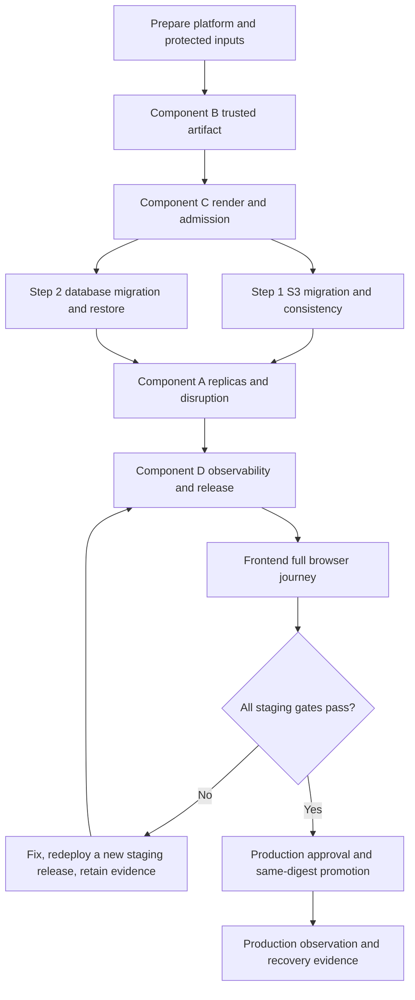

# Step 1–Component D live acceptance plan

วันที่จัดทำ: 2026-10-16

Repository: `C:/Users/Lenovo/tcg-store-backend`

Branch: `feat/kubernetes`

Pull request: [#39 — feat(kubernetes): prepare distributed backend releases](https://github.com/MUDST-2026-luntungsadungyong/tcg-store-backend/pull/39)

## 1. Context snapshot

Backend เป็น Spring Boot modular monolith ที่เก็บ business state ใน PostgreSQL, ใช้ stateless JWT และเปลี่ยน product image runtime เป็น S3-compatible storage โดยไม่มี filesystem fallback เป้าหมายของงานชุดนี้คือให้ API รันหลาย replicas ได้, ใช้ migration แบบ versioned, deploy ผ่าน Kubernetes อย่างควบคุมได้ และมีหลักฐาน observability/recovery ก่อน production

Environment ปัจจุบันแบ่งเป็น:

| Environment | Database | Object storage | Runtime |
|---|---|---|---|
| Local Docker Desktop | Local PostgreSQL | Adobe S3Mock | `docker-compose.desktop.yml` profiles |
| Local Kubernetes | PostgreSQL ใน local dependency namespace | S3Mock ใน local dependency namespace | Local overlay |
| Staging/production | Neon PostgreSQL หรือ approved external PostgreSQL | Neon S3-compatible object storage หรือ approved S3 provider | Kubernetes staging/production overlays |

Neon PostgreSQL และ Neon object storage เป็นคนละบริการ: PostgreSQL เก็บ relational/business data และ image URL/object key ส่วน object storage เก็บ binary image object การทดสอบจึงต้องยืนยันทั้งสองด้านและความสัมพันธ์ระหว่าง database row กับ object key

สถานะก่อนเริ่ม live acceptance:

- Step 1–Component D implementation อยู่ใน PR #39
- Maven clean test ผ่าน 195 tests, 0 failures/errors และมี 2 external-database skips
- Python renderer/release/smoke/dashboard suites ผ่านรวม 119 tests
- Kubernetes strict schema validation ผ่าน 55 resources
- Deployment adapter, Prometheus rules และ workflow lint ผ่านในเครื่อง
- ตรวจจริง 2026-10-16 พบ cloud objects 22 รายการตรงกับ managed image references 22 รายการ อ่านครบและไม่มี missing/orphan; cloud PUT/GET/public GET/DELETE probe ผ่าน ดู [ผล Step 1–2](./kubernetes-step-1-2-live-acceptance-results.md)
- Step 2 เคยพบ image ขาด Spring Boot 4 Flyway integration; แก้แล้วและ retest local fresh/repeat/legacy/restore/checksum drift/failure gate ผ่าน 6 scenarios พร้อม S3 validate-only สอง replicas ดูรายงานผลข้างต้น ยังรอ provider-side Neon branch/Kubernetes acceptance
- ยังไม่ได้ deploy งานรอบนี้ไป staging/production และยังไม่ได้ใช้ fixture/mock ปิด live acceptance
- Full browser mutation journey ยังไม่ครบ มี API harness และ browser read-only checks เท่านั้น

เอกสารที่เกี่ยวข้อง:

- [Master distribution plan](./kubernetes-backend-distribution-plan.md)
- [Component C acceptance](./kubernetes-component-c-acceptance.md)
- [Component D implementation status](./kubernetes-component-d-implementation-status.md)
- [Component D release operations](./kubernetes-component-d-release-operations.md)
- [Full-stack smoke runbook](./runbooks/full-stack-smoke.md)
- [Release recovery runbook](./runbooks/kubernetes-release-recovery.md)
- [Data restore rehearsal](./runbooks/data-restore-rehearsal.md)

## 2. Objective

ปิด acceptance ตั้งแต่ Step 1 ถึง Component D ด้วยหลักฐานจาก infrastructure จริง โดยยืนยันว่า:

1. รูปสินค้าและ database state ไม่ผูกกับ Pod/container ใดตัวหนึ่ง
2. Migration ปลอดภัย ทำซ้ำได้ และ failure หยุด rollout
3. Image ที่ deploy เป็น immutable, verified และเหมือนกันระหว่าง API/migration
4. Kubernetes routing, TLS, CORS, Secret และ NetworkPolicy ทำงานบน platform จริง
5. สอง replicas รองรับ outage, rollout, load และ scale โดยไม่ทำข้อมูลหรือ request สำคัญสูญหาย
6. Monitoring ตรวจจับ availability, latency, DB/S3 และ cluster failures ได้จริง
7. Staging ผ่าน full-stack journey ก่อน promote digest เดิมไป production
8. Rollback/recovery/restore มีหลักฐานและไม่ใช้ reverse migration ที่ไม่ปลอดภัย

## 3. Non-goals

- ไม่แยก backend เป็น microservices ในรอบนี้
- ไม่สร้าง cloud account, cluster, DNS zone หรือ Secret manager โดยอัตโนมัติ
- ไม่เก็บ credential/Secret value ใน Git, release bundle, test report หรือ command history
- ไม่ใช้ local image ID แทน published registry digest
- ไม่ใช้ mock, synthetic fixture หรือการเขียนสถานะ `healthy` ด้วยมือเพื่อปิด live acceptance
- ไม่รัน destructive production test ก่อน staging ผ่านและมี production approval

## 4. Remaining test matrix

| ส่วน | งานที่ยังต้องทดสอบจริง |
|---|---|
| Step 1 — S3 | ย้ายรูปสินค้าเดิมเข้า Neon S3 bucket จริง, ตรวจ URL ในฐานข้อมูล, upload/read ข้าม 2 instances, restart แล้วรูปยังอยู่, rollback/delete reference และตรวจ secret leakage |
| Step 2 — Database migration | Fresh database, upgrade database เดิม, migration ซ้ำ, migration failure ต้องไม่ rollout API, backup/restore กับ Neon จริง |
| Component A | 2 replicas บน cluster จริง, database outage, readiness/liveness, SIGTERM/in-flight request, rolling update, rollback, HPA, load test และ connection budget |
| Component B | Run บน `main` เพื่อสร้าง GHCR digest จริง, ตรวจ amd64/arm64, SBOM, provenance, Cosign signature, attestation และยืนยัน API/migration ใช้ digest เดียวกัน |
| Component C | Server-side admission จริง, Secret delivery, DNS/TLS, HTTP→HTTPS, Ingress, upload 8 MiB, CORS, rate limit, NetworkPolicy allow/deny, DNS/Neon/S3 connectivity |
| Component D | Deploy staging จริง, monitoring collector, Prometheus/Grafana/Alertmanager, observation window อย่างน้อย 600 วินาที, promotion production, rollback/recovery และ restore rehearsal |
| Frontend | Browser journey จริง: login → seller upload → catalog → cart → checkout → authorization |
| Cloud S3 | Inventory/reference audit และ disposable object roundtrip ผ่านแล้ว 22/22; เหลือ historical source mapping/checksum และ cloud API/replica acceptance ตามผล Step 1–2 |

## 5. Required inputs and ownership

| Input | Owner | Requirement |
|---|---|---|
| Protected-main build run | Backend/release owner | Successful trusted run ที่ publish immutable GHCR index |
| Staging/production cluster contexts | Platform owner | Context ชัดเจน, short-lived CI identity และ namespace/bootstrap พร้อม |
| DNS/TLS issuer/Traefik/CNI | Platform owner | Versions/labels ตรง Component C contract |
| Database credentials | Platform/DB owner | แยก runtime/migration roles และส่งผ่าน protected Secret delivery |
| S3 credentials/bucket | Storage owner | Dedicated staging bucket/prefix และ production bucket/prefix แยกกัน |
| Secret readiness metadata | Platform owner | Protected metadata file ผูก environment/namespace/Secret key names และ freshness |
| Frontend build/URL | Frontend owner | Immutable build identity, staging URL และ backend API URL ตรงกัน |
| Test accounts/data | QA/product owner | Dedicated admin/seller/buyers, known listing fixture และ non-sensitive image |
| Monitoring evidence | Platform/observability owner | Collector-backed file ผูก release digest/environment/rollout time |

ก่อนเริ่มต้องยืนยัน quota จริงของ Neon connections/storage, retention ของ release state, runner access policy และผู้อนุมัติ GitHub Environments `staging`/`production`

## 6. Execution order



Component B ต้องจบก่อน C/D เพราะ release bundle และ receipt ต้องผูกกับ published digest จริง Step 1 และ Step 2 สามารถเตรียมคู่ขนานหลัง staging prerequisites พร้อม แต่ Component A/D/full-stack tests ต้องใช้ schema และ object state ที่ยืนยันแล้ว

## 7. Phase 0 — Platform and safety preparation

### Actions

1. สร้างหรือเลือก staging cluster/context และยืนยันว่าไม่ใช่ production context
2. ติดตั้ง/ยืนยัน Traefik v3 + CRDs, cert-manager issuer, NetworkPolicy-capable CNI และ Metrics API
3. เตรียม namespace, runtime/migration ServiceAccounts และ external Secret delivery โดย CI ไม่มีสิทธิ์อ่าน Secret values หรือสร้าง Namespace
4. เตรียม Neon staging database branch และ staging object bucket/prefix ที่ไม่ปะปน production
5. เตรียม test accounts และ non-sensitive image fixture ที่ลบได้
6. ตั้ง GitHub Environment reviewers, protected variables/paths และ trusted runner label
7. บันทึก baseline database counts, bucket inventory, cluster nodes, quotas และ current deployed release ถ้ามี

### Gate P0

- Context/namespace/environment ตรงกันทุกจุด
- ไม่มี placeholder เช่น `replace.invalid` ใน protected release inputs
- Secret readiness metadata สดและ key names ครบ โดยไม่มี value ปรากฏใน log
- มี rollback owner และ maintenance window ก่อนเริ่ม mutation test

## 8. Phase 1 — Component B trusted artifact

### Test cases

| ID | Test | Pass criteria | Evidence |
|---|---|---|---|
| B-01 | Protected-main build | Run มาจาก repository/workflow/ref ที่อนุมัติและ commit ตรง source | GitHub run ID + source SHA |
| B-02 | Multi-architecture index | Index มี `linux/amd64` และ `linux/arm64` child manifests ตาม contract เท่านั้น | Index/child digests |
| B-03 | Security gates | Dependency/image/secret scans ไม่มี release-blocking finding | Workflow scan summaries |
| B-04 | Signature/attestation | Cosign identity/issuer, provenance และ child SPDX SBOM ตรวจผ่าน | Verification output แบบ redact |
| B-05 | Digest handoff | API และ migration ใช้ index digest เดียวกัน ห้ามใช้ `latest` | `image-contract.txt` และ rendered bundle |

### Gate B

ห้ามเริ่ม staging deploy หาก artifact ใดหมดอายุ, run identity ไม่ตรง, signature/attestation ขาด หรือ registry digest ไม่ตรง contract

## 9. Phase 2 — Component C render, admission and edge

### Test cases

| ID | Test | Pass criteria | Evidence |
|---|---|---|---|
| C-01 | Real-input render | Schema-v2 bundle render ด้วย digest จริงและไม่มี placeholder/Secret value | Retained seven-file bundle + hashes |
| C-02 | Server-side admission | Bootstrap/prerequisites/migration/application ผ่าน target API admission | Redacted dry-run output |
| C-03 | Secret/RBAC | Runtime/migration key names ครบ; CI ถูก deny `get/list Secret` และ `create Namespace` | Readiness metadata + `can-i` results |
| C-04 | DNS/TLS | Host resolve ถูก cluster, certificate hostname/chain ถูกต้องและ renewal พร้อม | DNS/certificate evidence |
| C-05 | Routing | HTTPS `/api` route เข้า backend, HTTP redirect/reject ตาม contract, `/actuator` ไม่ public | HTTP response matrix |
| C-06 | Upload boundary | Supported upload ผ่านและ request เกิน 8 MiB ถูก edge ปฏิเสธด้วย 413 | Request-size evidence |
| C-07 | Rate limiting | General/auth limits ให้ 429 ตาม policy และ client IP semantics ถูกต้อง | Timestamped response sample |
| C-08 | CORS | Approved frontend origin ผ่าน; origin อื่นไม่มี allow response | Browser/HTTP preflight matrix |
| C-09 | NetworkPolicy | Traefik/Prometheus เข้า API ได้; unauthorized Pod ถูกบล็อก; API ไป DNS/Neon/S3 ได้; migration ไป DB ได้แต่ไม่มี ingress | CNI connectivity matrix |

### Gate C

ต้องผ่าน real API-server admission, TLS/CORS และ CNI enforcement ห้ามถือว่า local render/schema pass แทน live acceptance

## 10. Phase 3 — Step 1 S3 and Cloud S3

### Preparation

- Backup database references ก่อนแก้
- Export source file/object inventory โดยไม่เก็บ credential
- กำหนด deterministic mapping ระหว่าง listing, object key และ public URL
- ใช้ dedicated prefix เช่น `products/<uuid>/...` และตรวจ exact public base path

### Test cases

| ID | Test | Pass criteria | Evidence |
|---|---|---|---|
| S3-01 | Existing-image migration | รูปเดิมทุกไฟล์ที่อยู่ใน scope มี object ปลายทางและ database reference ใหม่ ไม่มี missing/orphan ที่อธิบายไม่ได้ | Before/after counts + mapping checksum |
| S3-02 | Cross-replica upload/read | Upload ผ่าน replica A แล้วอ่าน metadata/object ผ่าน replica B ได้ | Request IDs, Pod names และ object HEAD/read result |
| S3-03 | Restart persistence | Replace/restart Pod แล้ว object และ URL ยังอ่านได้ | Pod lifecycle + read result |
| S3-04 | Transaction rollback | Database transaction ล้มหลัง upload แล้ว object ใหม่ถูก cleanup | Failed transaction ID + absence check |
| S3-05 | Shared reference deletion | ลบหนึ่ง listing แล้ว object ที่อีก listing อ้างยังอยู่; ลบ reference สุดท้ายจึง cleanup ตาม policy | Reference counts + object existence timeline |
| S3-06 | Validation/security | MIME/size/path validation ทำงานและไม่มี access/secret key ใน image, Git, logs หรือ reports | Negative cases + secret scan result |
| S3-07 | Provider URL scope | Returned URL เป็น HTTPS และตรง bucket/public-base path ที่อนุมัติ ไม่ยอมรับ neighboring prefix | API response + provider path check |

### Gate Step 1

จำนวน migrated/failed/skipped ต้อง reconcile ได้ทั้งหมด Database ห้ามมี filesystem URL ใหม่ และ bucket จริงต้องไม่ว่างเมื่อ database มี product image references

## 11. Phase 4 — Step 2 database migration and restore

### Test cases

| ID | Test | Pass criteria | Evidence |
|---|---|---|---|
| DB-01 | Fresh database | V1–latest apply สำเร็จและ application `ddl-auto=validate` start ได้ | Flyway history + health result |
| DB-02 | Legacy upgrade | Clone/branch จาก schema ก่อนหน้ารักษาข้อมูลสำคัญและ upgrade สำเร็จ | Before/after counts/checksums |
| DB-03 | Repeat migration | รัน migration ซ้ำแล้วไม่มี destructive change หรือ duplicate mutation | Second-run Flyway output |
| DB-04 | Failure gate | Intentional staging failure ทำให้ migration Job fail และ application รุ่นใหม่ไม่ถูก apply | Failed receipt + cluster state |
| DB-05 | Same image | Migration Job และ API Deployment ใช้ published index digest เดียวกัน | Rendered/live image IDs |
| DB-06 | Backup/restore | Backup ไป isolated restore target, Flyway validate ผ่านและข้อมูลหลักตรงกัน | Restore rehearsal record |

### Gate Step 2

ห้ามใช้ production database เป็น failure fixture ห้าม reverse SQL อัตโนมัติ และต้องมี verified backup/restore evidence ก่อน production migration

## 12. Phase 5 — Component A reliability and scaling

### Test cases

| ID | Test | Pass criteria | Evidence |
|---|---|---|---|
| A-01 | Two replicas/shared state | Requests กระจายอย่างน้อย 2 Pods โดย auth, DB และ S3 state ตรงกัน ไม่ใช้ sticky session | Access logs/request IDs + Pod distribution |
| A-02 | Database outage/recovery | Readiness DOWN, liveness UP ระหว่าง outage และ readiness ฟื้นโดยไม่ restart เมื่อ DB กลับ | Probe/event timeline |
| A-03 | Graceful SIGTERM | In-flight request จบภายใน termination window และ Pod หยุดรับ request ใหม่ก่อน exit | Drain/request timeline |
| A-04 | Rolling update | Service ยังตอบ smoke request ระหว่าง rollout และไม่มี request สำคัญถูกตัด | Success/error totals + rollout status |
| A-05 | Failed rollout/rollback | Bad release ไม่พร้อมรับ traffic; verified prior application/config คืนได้เมื่อ schema compatible | Failed/rolled-back receipts |
| A-06 | HPA/load | Scale up/down ตาม metrics โดยไม่ OOMKilled หรือเพิ่ม latency/error เกิน threshold | HPA samples + load report |
| A-07 | Connection budget | Peak connections จากทุก replicas ไม่เกิน quota และเหลือ operational reserve | Hikari + Neon quota samples |
| A-08 | Node disruption | บน multi-node Pods กระจายและ service รอดจาก drain/reschedule ตาม PDB; single-node บันทึกข้อจำกัด | Node/Pod event evidence |

### Gate A

กำหนด performance threshold จาก staging baseline ก่อนตัดสิน pass/fail และห้ามถือ HPA/PDB บน single-node ว่าเป็น node-level high availability

## 13. Phase 6 — Component D observability and staging release

### Test cases

| ID | Test | Pass criteria | Evidence |
|---|---|---|---|
| D-01 | Structured logs | Logs เป็น JSON, มี application/environment/request ID/route/status/duration และไม่มี JWT/password/body/query/Secret | Sanitized log samples |
| D-02 | Private metrics | Prometheus scrape `/actuator/prometheus` ผ่าน private path แต่ public Ingress เข้าไม่ได้ | Scrape target + public denial |
| D-03 | Signals | HTTP/JVM/Hikari/S3/kube-state/container/Neon quota signals มี environment/release labels ถูกต้อง | Metric query results |
| D-04 | Alerts | Availability, 5xx, latency, DB pressure, S3 errors, replica/restart/OOM/quota alerts firing/recovery ได้และ no-data เป็น UNKNOWN/hold | Alert timeline + receiver event |
| D-05 | Dashboard/log destination | Dashboard เลือก staging/production ได้และ log destination มี access control/retention | Dashboard capture + retention config |
| D-06 | Release lock | Concurrent release ถูกปฏิเสธ; Lease loss ก่อน apply ใด ๆ หรือหลัง migration ต้องหยุด | Lease/release records |
| D-07 | Observation window | Collector evidence เริ่มหลัง rollout, สด, ผูก exact digest/release และครอบคลุมอย่างน้อย 600 วินาทีจริง | Signed/protected observation file |
| D-08 | Recovery | Failure ก่อน/หลัง migration เข้า recovery state ถูกต้อง; rollback เฉพาะ backward-compatible verified bundle | Failure receipt + recovery outcome |

### Gate D staging

ต้องมี accepted staging receipt, retained candidate/accepted bundle, observation evidence และ smoke report ที่ผูก exact release ห้าม promote เมื่อ telemetry no-data, collector ขาด หรือ evidence ไม่ตรง digest

## 14. Phase 7 — Frontend full browser journey

Browser test ต้องใช้ deployed frontend build ที่ชี้ staging API จริง ปิด tracing/video ที่เสี่ยงเก็บ credential และใช้เฉพาะ dedicated test accounts/data

| ID | Journey | Pass criteria |
|---|---|---|
| FE-01 | Authentication | Buyer/seller login สำเร็จ, invalid credentials ถูกปฏิเสธ และ token ไม่ปรากฏใน artifact |
| FE-02 | Seller upload | Seller สร้าง listing พร้อมรูป, URL ชี้ approved cloud S3 path และเห็นจาก catalog |
| FE-03 | Catalog/search | Buyer ค้นหา/เปิดรายละเอียดและเห็น stock/status/image ถูกต้อง |
| FE-04 | Cart | เพิ่ม/แก้/ลบ cart ได้และ buyer อื่นเข้าถึงไม่ได้ |
| FE-05 | Checkout | Idempotency key เดิมไม่สร้าง order/ตัด stockซ้ำ และ order history ตรงกัน |
| FE-06 | Authorization | Buyer เข้า seller/admin paths ไม่ได้, seller จัดการ listing คนอื่นไม่ได้, unknown host/origin ถูกปฏิเสธ |
| FE-07 | Cleanup | ซ่อน/ลบ test listing และ cart fixture โดยไม่ลบ retained order/audit evidence ที่แผนกำหนด |

### Gate Frontend

เก็บ browser report ที่ระบุ frontend build ID, backend release ID, environment และเวลา โดยไม่บันทึก password/JWT/PII การมี API smoke อย่างเดียวไม่ปิด browser gate

## 15. Phase 8 — Production approval and promotion

1. ตรวจว่า PR/CI บน main ผ่านและ Component B artifact ยัง valid
2. ใช้ production GitHub Environment required reviewers
3. รับ exact staging run ID, accepted receipt และ retained bundle
4. Promote index digest เดิม ห้าม rebuild
5. รัน migration gate, rollout, read-only smoke และ fresh observation window
6. เปิด mutation smoke เท่าที่ production policy อนุญาตโดยใช้ isolated test identity/data
7. เก็บ promotion evidence และอัปเดต last-known-good pointer หลัง acceptance เท่านั้น
8. หาก failure ให้ใช้ phase-aware recovery; migration failure/unknown compatibility ต้อง manual recovery, monitoring no-data ต้อง hold, rollback เฉพาะ verified backward-compatible prior bundle

## 16. Evidence layout

Platform ควรเก็บหลักฐานนอก Git ใน protected release state โดยไม่มี Secret snapshots:

```text
<state-root>/
├── staging/
│   ├── releases/<release-id>/candidate-bundle/
│   ├── bundles/<release-id>/
│   └── <release-id>.json
├── production/
│   ├── releases/<release-id>/candidate-bundle/
│   ├── bundles/<release-id>/
│   ├── <release-id>.json
│   └── <release-id>-promotion-evidence.json
└── evidence/<release-id>/
    ├── artifact-verification/
    ├── database-restore/
    ├── object-migration/
    ├── cluster-reliability/
    ├── observability/
    └── browser/
```

ทุก evidence ต้องระบุ environment, release ID, source SHA, immutable index digest, UTC timestamps และผู้/ระบบที่สร้างหลักฐาน พร้อม retention/access policy

## 17. Stop conditions

หยุด release ทันทีเมื่อ:

- Environment/context/namespace/digest ไม่ตรงกัน
- พบ Secret value ใน Git/log/artifact/report
- Signature/provenance/SBOM หรือ registry identity ตรวจไม่ผ่าน
- Backup/restore evidence ไม่มีหรือ restore ใช้งานไม่ได้
- Migration fail หรือ API ถูก apply ก่อน migration สำเร็จ
- Lease สูญหาย/หมดอายุ หรือมี release ซ้อนกัน
- TLS/CORS/NetworkPolicy เปิดกว้างกว่าสัญญา
- Error rate, latency, DB quota, S3 consistency หรือ data integrity เกิน threshold
- Observation evidence เป็น no-data, stale, backdated หรือไม่ผูก exact rollout
- Full browser authorization/idempotency test ล้ม

## 18. Completion checklist

- [ ] P0 platform/safety prerequisites ผ่าน
- [ ] Component B trusted artifact ผ่าน
- [ ] Component C admission/edge/network ผ่าน
- [ ] Step 1 local/cloud S3 migration and consistency ผ่าน
- [ ] Step 2 migration/failure/backup-restore ผ่าน
- [ ] Component A two-replica/disruption/load/connection budget ผ่าน
- [ ] Component D monitoring/alerts/release/recovery ผ่าน
- [ ] Frontend full browser journey ผ่าน
- [ ] Staging accepted receipt และ observation evidence ครบ
- [ ] Production approval และ same-digest promotion ผ่าน
- [ ] Production observation/recovery evidence ครบ
- [ ] Master plan และ Component D status อัปเดตเป็น Complete พร้อมลิงก์หลักฐาน

Component D และแผน Kubernetes ทั้งชุดถือว่า complete ได้ต่อเมื่อ checklist นี้ปิดครบโดยใช้หลักฐานจริง ไม่ใช่เพียง workflow/configuration มีอยู่ใน repository
